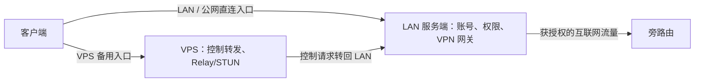

# NetGo

NetGo 将账号、权限、管理网页和 VPN 网关部署在局域网 Debian 服务器上，让获授权的客户端访问指定的局域网设备。可选的一台 VPS 提供备用控制入口及 Relay/STUN 中继；账号和权限仍由 LAN 服务端管理。

客户端推荐 **导入管理员导出的站点文件 → 登录 → 选择资源或设备**。导入会带入所有连接参数；需要特殊配置时仍可手工新建服务器。Windows 日常只打开 **NetGo.exe**，首次网络授权由程序发起。

当前为 **0.3.0-dev / API v2 / schema 3 开发版**。LAN/VPS 的 VPN、账号授权、旁路由出口及安装维护已有实机验证；此前七个平台的构建已通过；本次提交的复验状态单独记录。远程桌面已接入部分平台和共享会话组件，**两台设备之间完整的画面、键鼠、音频及恢复流程尚未完成实机验收**。构建成功不表示全部远控或全部设备功能已可稳定使用。

本次审查后的修复、模块拆分、必要验证与目录清理见 [2026-11-26 修复与收敛记录](docs/REFACTOR_FINAL_2026-11-26.zh-CN.md)。schema 1/2 数据库会被拒绝打开，需要新目录初始化；不提供自动迁移或双写。远控支持观看、输入、音频、剪贴板、上传、下载六项独立权限，实际能力以主机协商结果为准；Windows、macOS、Linux 可作为被控端，可选择本地同意或明确启用无人值守。管理审计与已结束的远控记录分别分页。

## 1. 下载哪个包

从 [GitHub Actions](https://github.com/sck03/NetGo/actions) 选择对应工作流最近一次成功的运行，在页面底部下载 Artifacts。Actions 下载的 ZIP 是外层归档；解压后，再找到下表中的运行包。不要使用 GitHub 的源码 ZIP 代替安装包。

| 使用位置 | 工作流 | 要使用的运行包 |
| --- | --- | --- |
| 局域网 Debian 服务端 | [Linux server](https://github.com/sck03/NetGo/actions/workflows/build-linux-server.yml) | `NetGo-0.3.0-dev-linux-amd64.zip` 或 `NetGo-0.3.0-dev-linux-arm64.zip`，通常位于 `dist/linux-server/` |
| VPS 辅助节点 | [VPS auxiliary node](https://github.com/sck03/NetGo/actions/workflows/build-vps.yml) | `NetGo-0.3.0-dev-vps-linux-amd64.zip` 或 `NetGo-0.3.0-dev-vps-linux-arm64.zip` |
| Windows 客户端 | [Windows client](https://github.com/sck03/NetGo/actions/workflows/build-windows-client.yml) | `NetGo-0.3.0-dev-windows-amd64-Setup.exe` 或 `NetGo-0.3.0-dev-windows-amd64-portable.zip`，位于 `dist/windows-client/` |
| Linux 桌面客户端 | [Linux desktop client](https://github.com/sck03/NetGo/actions/workflows/build-linux-client.yml) | `NetGo-0.3.0-dev-linux-client-amd64.tar.gz`，解压后打开 `netgo-desktop` |
| Android 客户端 | [Android client](https://github.com/sck03/NetGo/actions/workflows/build-android-client.yml) | 调试 APK 用于测试；未签名 APK 需签名后安装 |
| macOS 客户端 | [macOS client](https://github.com/sck03/NetGo/actions/workflows/build-macos-client.yml) | macOS ZIP 中的 `NetGo.app`，目标设备上的权限和功能仍待验收 |
| iPhone/iPad 客户端 | [iOS client](https://github.com/sck03/NetGo/actions/workflows/build-ios-client.yml) | 设备 IPA 需有效签名；模拟器 ZIP 用于 Xcode 模拟器 |

Linux 服务端和 VPS 另提供 `arm64` 包。Actions 的 architecture 选择 `arm64`，将在原生 ARM runner 上构建；安装脚本根据机器架构选择对应安装器，并逐个检查包内 ELF。ARM 设备运行验收范围见本轮记录。

版本号以实际下载文件为准。各平台脚本和工作流独立维护，见 [构建说明](docs/BUILD_CLIENTS.zh-CN.md)。

手动点击 Run workflow 后，可设置版本号、目标架构、是否发布到 Releases、草稿/预发布/正式类型；Android 还可设置 versionCode，Apple 可设置构建号，iOS 可选择设备/模拟器。自动 push 构建默认不发布。需要在线一键安装时，应将 LAN/VPS 两个工作流的运行包及校验文件发布到同一个正式 Release。

如果仍只看到截图中的分支选择，请刷新对应工作流页面并选择 main。正式发布示例：version 填 `0.3.1`，勾选 publish，release_type 选择 stable；只下载 Actions 构建产物时保持 publish 不勾选。参数和本轮验证见 [构建与发布说明](docs/BUILD_CLIENTS.zh-CN.md)。

## 2. Debian 服务端一键安装与维护

**有独立的一键安装脚本 `install-server.sh`。** 它安装程序并打开交互菜单；后续输入 **`ng`** 即可修改设置或卸载。运行和维护不需要 Python、Node 或 Go 编译器。

目前支持 Debian 12/13、amd64 / arm64、systemd。先下载与机器架构对应的服务端运行包，复制到服务器；以下以 amd64 为例，假设文件放在 `/root/`，并在 root 终端执行：

```sh
unzip /root/NetGo-0.3.0-dev-linux-amd64.zip -d /root/NetGo-server
cd /root/NetGo-server
bash install-server.sh
```

如果没有 `unzip`，先安装该系统工具：`apt-get update && apt-get install -y --no-upgrade unzip`。

首次在菜单选择 **1) 首次配置 / 启动服务**：按检测出的地址选择 LAN 网卡，填写站点名称，接受推荐设置，再生成证书并创建管理员。站点 ID 自动生成；默认使用本机 LAN 地址和 HTTPS 10443 / Relay 18443 / STUN 3478。特殊域名、端口和网段可在高级配置中修改。

**内网 IP 只能用于内网连接。** 完成初始化后，在“设置外网访问”中添加公网直达入口（需路由器端口映射等）或配对 VPS。

完成后，在同一局域网的浏览器打开安装时的站点网址，例如 `https://192.168.18.220:10443/`，登录管理网页创建普通账号并分配资源权限。私有 CA 站点需在管理浏览器中信任管理员提供的公共 CA 证书；客户端导入的站点 JSON 会携带所需公共 CA。

日常使用菜单：

| 命令/菜单 | 操作 |
| --- | --- |
| `ng` | 打开 LAN 管理菜单 |
| 1) 首次配置 / 启动服务 | 自动检测网卡、推荐配置、创建管理员 |
| 2) 查看连接与运行状态 | 查看内网 / 外网入口和服务状态 |
| 3) 设置外网访问 | 配对 VPS；管理 LAN / 公网直达入口 |
| 4) 添加客户端 | 导出公共站点文件交给用户 |
| 5) 高级网络与证书设置 | 身份、端口、证书和互联网出口 |
| 6) 检查并恢复服务 | 运行检查和恢复 |
| 7) 检查旁路由与局域网配置 | 检查网卡、路由、转发和 DNS，显示故障处理建议 |
| 9) 卸载（保留数据） | 移除受管对象，保留配置及数据 |

命令行卸载也可使用 `ng uninstall --yes`。重装时在保留的运行包目录执行 `bash install-server.sh install --source /root/NetGo-server --install-only`，再打开菜单选择首次配置/启动，恢复已有站点。完整参数见 [安装与维护说明](docs/INSTALLERS.zh-CN.md)。

### 在线下载的一条命令：当前尚缺 Release

**截至 2026-11-25，仓库没有 GitHub Release。** 当前可用的是上述 Actions 运行包内的一键安装。仅下载仓库根目录的脚本，会因找不到 Release 安装器而返回 404；下载源码也不包含这些已编译程序。

通过工作流发布包含安装器、平台包及各自 `.sha256` 文件的正式 Release 后，以下在线入口才可使用。仅有预发布版本不会使 GitHub 的 `releases/latest` 入口生效：

```sh
# LAN 服务端：在 root 终端运行，正式 Release 发布后可用
curl -fL https://raw.githubusercontent.com/sck03/NetGo/main/install-server.sh -o install-server.sh && bash install-server.sh

# VPS 辅助节点：在 VPS 的 root 终端运行，正式 Release 发布后可用
curl -fL https://raw.githubusercontent.com/sck03/NetGo/main/install-vps.sh -o install-vps.sh && bash install-vps.sh
```

## 3. VPS 辅助节点一键安装

VPS 使用另一份独立脚本 **`install-vps.sh`**，安装后输入 **`ngv`** 打开菜单。VPS 上的 `frps` 负责备用控制转发，Relay/STUN 负责 VPN 中继；LAN 上使用 `frpc` 与 VPS 建立控制隧道。

先完成 LAN 站点初始化，再按以下顺序操作：

1. 在 LAN 的 `ng → 3) 设置外网访问 → 配对 / 管理 VPS` 中选择推荐设置，只填写 VPS 公网 IP / 域名，再生成节点证书，导出 `/root/NetGo-vps.zip`。
2. 将 **VPS 程序安装包**和这个 **节点配置包**分别复制到 VPS。
3. 在 VPS 上解压程序安装包并运行安装脚本：

```sh
unzip /root/NetGo-0.3.0-dev-vps-linux-amd64.zip -d /root/NetGo-vps
cd /root/NetGo-vps
bash install-vps.sh
```

4. 在 `ngv` 菜单选择 **1) 导入配对包 / 启动节点**，填写 `/root/NetGo-vps.zip`。
5. 回到 LAN 的 `ng → 4) 添加客户端`，重新导出站点 JSON，客户端导入后即可自动选择 LAN 直连或 VPS 备用入口。

`NetGo-0.3.0-dev-vps-linux-amd64.zip` 安装程序；LAN 导出的 `NetGo-vps.zip` 配置该节点。后者含节点 TLS 私钥和通信密钥，只在 LAN/VPS 管理员之间传递，客户端用户使用的是 `NetGo-site.json`。

日常用 `ngv` 修改端口、更新证书、诊断或卸载；命令行卸载为 `ngv uninstall --yes`。VPS 改端口后，应把其导出的新设置导回 LAN，再重新导出客户端 JSON。

## 4. Windows 客户端怎么填

**“新建服务器”窗口可以直接手工配置，导入不是强制要求。** 填好下面的真实参数即可保存并连接；没有 VPS 时不需要填写备用入口。使用 VPS 时，直接在表单填写“VPS 入口”和“VPS 中继”，或者导入已包含这些参数的站点 JSON。

想减少逐项填写，可在 LAN 执行 `ng → 4) 添加客户端`，将生成的 JSON 复制到电脑，在 NetGo 主界面点击“导入”。文件会同时带入站点 ID、控制网址、直达/备用入口、VPN 网关、公共 CA 和中继信息。

手工配置时，截图字段的含义如下：

| 截图字段 | 填什么 | 示例/来源 |
| --- | --- | --- |
| 显示名称 | 便于自己识别的名称 | “家里的服务器”，可以自定义 |
| 站点 ID | LAN 站点实际的 `ID` | 从导出文件读取；不要直接沿用示例 `site1` |
| 站点网址 | **LAN 站点的固定控制身份 `Origin`**，包含 `https://` 和控制端口 | 例如 `https://192.168.18.220:10443`，或安装时配置的控制域名；使用 VPS 时仍沿用导出值 |
| 直达入口 | **直接到 LAN 服务端的控制入口**，格式为 `主机:端口` | LAN 内可用 `192.168.18.220:10443`；外网直达需可达的公网地址/域名及对应端口映射 |
| 路由虚拟 IP | LAN 的 NetGo VPN 网关在 VPN 内部的地址，即 `GatewayIP` | 从导出文件读取；截图中的 `100.96.0.1` 只是示例，不能填 LAN IP 或旁路由 IP |
| 证书信任 | 私有 CA 使用站点文件中的公共 CA，手工配置时导入管理员提供的 `ca.crt` | “使用系统信任”适用于系统已信任的证书；不导入私钥 |
| 本地中继 | **LAN 上的 Relay 主机名或 IP**，即 `LocalRelay` | 例如 `192.168.18.220`；不加 `https://`、`rels://` 或端口；不填写 VPS |

新建／编辑表单现可直接填写 **VPS 入口**（备用 `Candidates`）及 **VPS 中继**（`AuxiliaryRelay`）。直达入口和 VPS 入口均支持多个 `主机:端口`，用空格分隔；未修改的入口保留 ID。编辑已有站点时填写管理员提供的新配置版本，或者导入新导出的文件。

例如，LAN 控制入口是 `192.168.18.220:10443`，VPS 备用入口是 `203.0.113.10:24443`。外网客户端连不上 LAN 私有地址时，会选择 VPS 入口；**控制网址仍保持 LAN 站点的原值**。VPS 将请求转回 LAN，客户端验证同一站点的证书。`203.0.113.10` 是文档示例，实际地址以导出文件为准。



本地/VPS Relay 的真实连接端口由服务端下发。“本地中继”用于识别本地 Relay 路径，不用靠修改它来选择 VPS。详细格式及排错见 [Windows 使用说明](docs/WINDOWS_CLIENT.zh-CN.md)。

## 5. 端口与旁路由

以下是独立端口模式的默认值，修改后以服务端导出的配置为准：

| 节点 | 用途 | 默认端口 | Windows 中对应什么 |
| --- | --- | --- | --- |
| LAN | HTTPS 控制/管理网页 | TCP `10443` | 控制网址、LAN 直达入口 |
| LAN | Relay 中继 | TCP/UDP `18443` | 服务端下发；“本地中继”只填主机 |
| LAN | STUN | UDP `3478` | 服务端下发 |
| VPS | 备用控制入口 | TCP `24443` | 备用 `Candidates` |
| VPS | LAN→VPS 控制隧道 | TCP `27000` | LAN/VPS 维护器配置，客户端不填 |
| VPS | Relay 中继 | TCP/UDP `28443` | 服务端下发、`AuxiliaryRelay` 标识 |
| VPS | STUN | UDP `3478` | 服务端下发 |

SSH 端口用于管理员登录机器，与 NetGo 客户端入口无关。共享 443 模式的条件和端口配置见 [安装说明](docs/INSTALLERS.zh-CN.md)。

旁路由在 LAN 的 `ng → 5) 高级网络与证书设置 → 互联网出口` 中配置。例如 IP 和 DNS 都使用 `192.168.19.254`，支持普通 DNS 和 Clash/Mihomo 的 `198.18.0.0/15` Fake-IP。**管理员还必须给账号授予“互联网（旁路由）”资源**，客户端勾选互联网模式才可使用；局域网设备权限单独授予。这个地址不填到 Windows 的“路由虚拟 IP”或“本地中继”中。

旁路由设置使用独立的 VPN 入站策略，保留服务器原有默认网关。客户端不再要求与服务端时差小于 30 秒，采用可信服务端时间和单调经过时间；证书、签名、防重放和租约期限检查仍保留。

遇到访问问题，先在 LAN 执行 **ng → 7) 检查旁路由与局域网配置**（也可运行 `ng check-network`）。检查会读取网卡、受管策略路由和所有 DNS，不修改配置。旁路由向导默认检测全部主备 DNS；查询失败时保留原配置并说明原因，备用 DNS 返回 Fake-IP 时也会启用对应路由。

本轮已增加 Windows/macOS/Linux 被控主机、GPU 硬件编码路径、登录会话无人值守，以及各控制端文本剪贴板和文件传输。使用步骤、系统限制与实测范围见 [远控功能说明](docs/REMOTE_HOST_FEATURES.zh-CN.md)。

远程桌面列表保留有观看权限的主机，并显示“可连接 / 正在使用 / 主机失联 / VPN 未连接 / 共享已关闭”等服务端状态；只有可连接的主机才能启动会话。Windows 支持仅观看、声音开关、F11 全屏和随显示器缩放的工具栏。刷新保留选中的电脑；刷新失败会清空旧列表并提示重试。授权表单只展示主机实际支持的能力，可修改已有权限和到期时间。客户端、LAN 服务端和管理网页应同步使用本轮构建。

管理网页“局域网资源”会显示服务器网段、网卡和旁路由网关 / DNS。新建资源必须位于配置的 LAN 网段内，互联网资源需先配置旁路由才能启用；配置摘要不代表实际连通测试。窄窗口使用顶部可横向滚动的导航栏，可以继续切换账号、资源和远程桌面页面。

## 6. 文档与验证

- [安装、卸载与离线参数](docs/INSTALLERS.zh-CN.md)
- [Windows 客户端与字段对照](docs/WINDOWS_CLIENT.zh-CN.md)
- [五客户端、LAN/VPS 的独立构建](docs/BUILD_CLIENTS.zh-CN.md)
- [本轮实机与七平台构建记录](docs/evidence/2026-11-24-platforms/REPORT.zh-CN.md)
- [当前进度](docs/PROGRESS.zh-CN.md)、[任务清单](docs/IMPLEMENTATION_BACKLOG.zh-CN.md)
- [完整执行方案](docs/EXECUTION_PLAN.zh-CN.md)、[远控多平台方案](docs/REMOTE_NATIVE_PLAN.zh-CN.md)
- [固定版本](upstream/versions.lock.json)、[第三方通知](THIRD_PARTY_NOTICES.md)

开发者使用各平台独立构建脚本，详细工具链与检查入口见构建说明。项目采用新接口和新数据，不提供旧开发数据库或旧 API 兼容。

产品操作的简化方向、成熟软件对照与新菜单说明见 [产品对照与操作简化](docs/PRODUCT_SIMPLIFICATION.zh-CN.md)。
