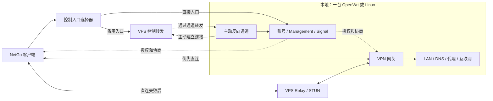

# NetGo 架构与实施规划

> 历史方案：最新需求已收敛为 Linux 服务端、局域网设备访问和可选 VPS。实施请以 [完整执行方案](EXECUTION_PLAN.zh-CN.md)、[任务清单](IMPLEMENTATION_BACKLOG.zh-CN.md)与[验收手册](NETWORK_ACCEPTANCE.zh-CN.md)为准；本文件保留用于追溯早期 OpenWrt/出口代理讨论。

日期：2026-11-21（Asia/Shanghai）。状态：架构规划，尚未实现或完成网络实测。

本文件中的“设计”“目标”“建议”均为拟实现行为；上游已有能力以文末来源编号标注。实施时锁定上游版本、提交、依赖和构建参数，不直接跟随 main 或浮动容器标签。

## 1. 需求与边界

1. 本地选用一台 OpenWrt 或 Linux，能够同时承担账号、设备授权、连接控制和 VPN 网关；不强制再加一台局域网控制机。
2. 本地公网 IPv4、IPv6 和端口映射可能变化或消失；判断实际可达性，不以“网卡有公网地址”代替连通性测试。
3. VPS 提供稳定的 STUN、数据中继，以及必要的本地控制入口转发；本地主动连接 VPS，反向通道不能依赖尚未建立的用户 VPN。
4. 客户端优先直连，NAT 穿透成功也属于直连；失败才用中继。控制请求与 VPN 数据分别选择路径。
5. VPS 不是所有连接的强制入口。本地控制和数据入口可达时，VPS 停机仍要支持首次登录、设备注册、客户端重启和重新连接。
6. 账号与权限以本地服务为准。VPS 不维护第二套用户密码库。
7. 用户通过服务器列表和账号密码连接；支持 LAN、互联网出口、DNS 与管理员配置的代理。
8. 默认阻止普通用户互访；设备限额、封禁、到期和踢下线必须在服务端执行。
9. 参考原项目的产品流程和网络适配，替换 OpenConnect/ocserv 后端，不承诺原客户端协议兼容。[S1][S2]

本地无入站公网入口但有出站网络时，可以打洞或中继。本地整机断网/停机时，VPS 无法让它继续提供出口。VPS 已停机且双方不存在任何可用直连路径时，必须有另一个可用辅助节点；单 VPS 版本不承诺这种情况下仍能连接。

## 2. 推荐路线：复用完整连接生态

首选复用 NetBird 客户端、Management、Signal、Relay/STUN，再开发 NetGo 产品层和必要的最小适配。先做可行性验证，再决定长期分支。

| 路线 | 可复用能力 | 主要新增工作 | 定位 |
| --- | --- | --- | --- |
| NetBird 完整协议链 | 设备注册、密钥、控制、穿透、中继、本地身份 | 入口切换、认证适配、产品界面、平台网络适配 | 首选验证 |
| Tailscale + Headscale + DERP/STUN + 本地身份服务 | Tailscale 客户端与兼容控制、中继 | 本地身份接入、入口切换、产品与平台适配、版本兼容 | 备选比较 |
| WireGuard 库 + 自行拼装其他项目中继 | 隧道加密和部分系统接口 | 设备控制、候选交换、打洞、协商、中继鉴权、恢复 | 第一版不采用 |

NetBird 已有本地用户、外置 Relay/STUN 和客户端本地 RPC；这些基础适合先在上游进程外围集成。[S3][S4][S5]

Tailscale 的官方控制服务没有开源；完全自建需采用 Headscale 等替代实现。Headscale 支持 OIDC、路由和中继。[S6][S7]

NetBird Relay 与 DERP 是各自协议生态的组件，不能将另一种中继地址填入配置就视为兼容。第一版保持完整协议链，不开发跨协议转换。[S6][S8]

## 3. 部署分工

### 3.1 本地：一台 OpenWrt 或 Linux

| 模块 | 建议实现 | 职责 |
| --- | --- | --- |
| NetGo 管理服务 | Go + Web 管理页 | 配置、账号管理入口、策略、备份和诊断 |
| 身份服务 | 优先 NetBird 内嵌身份服务 | 单一账号来源、密码校验和令牌 |
| Management | 固定版本上游服务 | 设备、公钥、组、权限与路由 |
| Signal | 留在本地 | 交换连接信息和协商；两种入口访问同一实例 |
| 网关连接引擎 | NetBird 客户端 | 隧道、LAN 转发、互联网出口 |
| TLS 控制入口 | HTTP/2/gRPC 兼容路由 | 认证、Management 与 Signal 路径 |
| 反向通道客户端 | 优先复用 frpc 等成熟工具 | 主动连接 VPS，转发控制入口 |
| 可达性/DDNS 管理 | NetGo 模块 | 地址变化、实际端口、候选更新 |
| 网络适配器 | OpenWrt/Linux 分别实现 | 防火墙、路由、DNS、代理和恢复 |

Management/Signal 只有本地这一份活动实例，不把另一个独立数据库放在 VPS 上进行未设计的双主同步。[S3]

### 3.2 外部 VPS：辅助连接

| 模块 | 建议实现 | 职责 |
| --- | --- | --- |
| STUN | NetBird Relay 自带服务 | 帮助设备发现公网映射 |
| 数据中继 | NetBird Relay | 转发端到端加密流量 |
| 反向通道服务端 | frps 等 | 接收本地主动建立的连接 |
| 控制入口转发 | 优先四层转发 | 将认证/管理/信令请求送到本地 |
| 运维 | 最小配置与健康检查 | 通道鉴权、日志、资源和容量 |

外置 Relay/STUN 是上游能力；反向控制通道和多入口组合是 NetGo 集成工作。frp 有 TCP 转发、加密与认证能力，优先验证成熟组件。[S17][S9][S10]

控制请求的 TLS 优先在本地终止，反向通道另行认证与加密。VPS 不保存本地控制域名私钥和用户密码，但仍能观察连接元数据；不能描述成完全看不到信息。



## 4. 控制请求与数据分别选路

| 控制请求 | VPN 数据 | 目标行为 |
| --- | --- | --- |
| 直接到本地 | 直接到网关 | 完全不要求 VPS 在线 |
| 经 VPS 转发到本地 | 打洞后直接到网关 | 允许，不能因登录走 VPS 就强制中继 |
| 直接到本地 | 经 VPS 中继 | 允许，例如数据直连被网络限制 |
| 经 VPS 转发到本地 | 经 VPS 中继 | 允许 |

数据直连/中继由核心处理。界面显示真实路径，不能只看 IP 或登录入口就声称直连。中继数据最终仍到本地网关，网站看到的出口取决于本地及代理策略，不自动变成 VPS。[S8][S11]

## 5. 首要开发难点：控制入口切换

### 5.1 一个站点身份，多个到达地址

每个本地站点有稳定的控制逻辑域名、TLS 身份、OIDC issuer 和站点标识。连接配置保存 LAN、公网 IPv4/IPv6、DDNS、VPS 反向入口和后续备用节点。

选择实际 TCP 目的地址时，保持 HTTP authority、TLS SNI 和认证身份一致。不能只切两个不同 management URL，忽略 discovery、issuer、令牌受众、回调和设备所属站点。[S5][S12]

DNS 权威服务独立于该 VPS；本地更新直达地址，客户端持久保存候选和上次成功地址。直达地址的唯一发现 API 也不能放在该 VPS 上。

第一版默认管理员有可控制的域名。无域名的纯 IP/固定公钥模式后续单独设计，不混用浏览器/OIDC 的域名假设。

### 5.2 客户端入口选择器

1. 无需 VPN 即可读取候选和站点信任信息。
2. 有时限地探测 TCP、TLS 和应用状态，先验证服务身份。
3. 优先直达，短时未成功即启动 VPS 候选；避免串行长时间超时。
4. 认证、刷新、Management gRPC、Signal 和 WebSocket 都接入同一选路机制。
5. 断线后恢复订阅；注册等写操作幂等，避免入口切换造成重复设备。
6. 失败退避、恢复确认和手动诊断入口，避免公网波动时来回切换。
7. 分别记录控制入口和数据路径，不将二者绑定。

先检查配置或统一传输代理能否满足；不足时在 NetBird 客户端传输层维护最小补丁。不假定原版客户端已经支持这些行为，也不把修改系统 hosts 作为正式实现。

### 5.3 身份和浏览器的限制

系统浏览器不会自动使用 NetGo 的自定义拨号器。只修改 daemon 的 gRPC 不足以证明网页认证故障切换有效。本地服务读取 issuer/JWKS 时也需有不经过 VPS 的路径。[S12]

POC 先以标准认证验证协议，然后验证客户端内账号窗口。不能用抓取登录页和模拟表单替代长期认证接口。

### 5.4 VPS 全停时的数据冷启动

必须证明没有外部 STUN/Relay 时，仍能向客户端发布可用的本地公网地址和 UDP 端口。优先复用固定端口、外部地址映射等上游配置，必要时小幅适配候选发布。[S11][S13]

上游具备相关配置不等于冷启动已经通过。验收关闭该 VPS 的控制转发、Relay、STUN，并排除默认公共节点的隐藏依赖。本地可选 STUN 仅作公网可用时的补充，不能代替外部辅助节点在无公网阶段的职责。

## 6. 账号、设备和撤销

单一身份来源优先放在 NetBird 内嵌身份服务。NetGo 元数据只保存站点、设备限额、策略、会话租约和审计关联，避免两套密码库。上游默认邮箱登录，短用户名需做别名与稳定用户 ID 的映射。[S5]

认证分两步交付：

1. POC 用标准 OIDC 流程，确认真实用户归属、入口切换和令牌刷新。
2. 产品版实现窗口内账号密码，通过受控的本地身份扩展取得用户/设备/站点绑定的短期授权，再接入连接引擎。具体令牌交换与 daemon 接口由固定版本源码验证后确定；这是交付条件，不能省略成“上游已有账号所以不用开发”。

不默认开启 OAuth 密码授权，不用共同 setup key 代替所有用户登录。网关设备可以单独使用管理用途注册凭据，但不得混同普通用户身份；setup-key 设备的登录到期行为与用户设备不同。[S14]

模型至少包含站点、用户、设备、公钥、会话、网关/LAN/出口权限、设备上限、有效期和撤销版本。

默认保留原项目“一个账号同时一台在线”的语义。账号可登记多设备，接入时通过本地服务原子取得会话租约；新会话按策略拒绝或替换旧会话，并在网关回收旧权限。基础验证可以先限制一台已授权设备，但不能将其当作同时在线限制的完整交付。[S1]

封禁、到期、踢下线必须在网关撤销流量权限/密钥授权并清理必要连接状态，不能只退出网页或等待客户端配合。即便客户端不合作、VPS 不在线，本地仍须执行期限；策略与本机防火墙如何协作列入 POC。

## 7. 平台与网关功能

共用目标：用户设备管理、LAN、互联网出口、DNS、代理能力检测、诊断、备份、升级和卸载恢复。默认用户隔离，使用服务器侧权限控制。

### 7.1 OpenWrt

先验证资源充足的 arm64/x86_64。官方软件包提供加入既有部署的客户端，不能因此认定完整本地控制服务能在任意路由器运行。Management、身份、数据库、TLS、musl/CGO 和资源占用要实机验证。[S15]

交付 procd、UCI、LuCI 和原生包，默认不强制 Docker。处理 fw4/nftables、路由、TUN/WireGuard、dnsmasq 监听冲突，避免多个管理器同时操作接口与密钥。[S15]

分别适配 OpenClash、Nikki、Momo；参考原项目的 VPN 专用代理隔离、能力登记、受管规则和事务恢复。[S1][S2]

Linux 容器成功不算 OpenWrt 单机完成。目标设备资源不足时明确报告不支持；“额外加 Linux 控制机”只能作为可选部署，不能冒充单机要求已满足。

### 7.2 Linux

先验证 amd64/arm64 Debian/Ubuntu 类系统。容器用于 POC，生产安装提供 systemd；按实测决定是否保留可选容器部署。

普通 LAN 服务器先提供 SNAT，减少其他 LAN 设备回程配置；保留真实 VPN 源地址时需主路由配置回程。与现有 nftables/firewalld/UFW 协作，不覆盖整套规则。

先实现 LAN、出口和 DNS，再接入明确支持的代理。OpenWrt 插件适配不能直接宣称在 Linux 等价可用。

### 7.3 全隧道和地址冲突

控制入口、反向通道和辅助连接保留物理网络路径，避免 VPN 默认路由把自身控制连接送回隧道。验证例外路由、标记、DNS 引导和 IPv6。

客户端 LAN 与远端 LAN 网段冲突时给出诊断；先支持无冲突网段/较窄路由，复杂地址映射后续单独实现。

## 8. 客户端接入

桌面先采用 NetGo 界面 + 独立连接服务，受保护的 Unix socket/Windows 命名管道对接固定版本 NetBird daemon RPC。RPC 适合集成连接、断开和状态，不代表可替换全部核心传输。[S4]

显示服务器、账号、登录/连接状态、控制入口、数据路径、当前中继、地址、流量和诊断。普通连接流程不要求用户理解 Management 或 ICE。

导出配置包含站点身份、候选、信任、版本和辅助节点，不包含密码、私钥或管理令牌。与原项目格式是否兼容单独评估，不沿用旧版本号表示新协议。

多个站点隔离身份、密钥和缓存；首版同时连接一个站点。辅助 VPS 可在明确鉴权隔离下共享，账号仍属于各本地站点。

建议先 Windows 桌面和 Linux 验证客户端，再 Android，随后 macOS/iOS。移动端使用其系统 VPN 接口和平台绑定，不能直接搬桌面 daemon；Apple 签名与扩展权限属于交付依赖。

原项目可借鉴列表、导入导出、托盘、日志、取消、重连和迟到回调隔离；不搬 OpenConnect 会话层接到 NetBird 引擎。[S1][S2]

## 9. 端口与协议规划

| 位置 | 用途 | POC 建议 |
| --- | --- | --- |
| 本地 | TLS 控制入口 | TCP 443 或独立可配置端口 |
| 本地 | 数据直连 | 固定 UDP 端口，核查实际绑定和公网映射 |
| VPS | NetBird Relay | TCP/UDP 443，WebSocket/QUIC |
| VPS | STUN | UDP 3478，可配置 |
| VPS | 控制四层转发 | 独立 IP/端口或验证后的复用 |
| VPS | 反向通道 | 独立鉴权入口，本地主动出站 |

frps 转发和 Relay 不能同时直接占用相同 IP 的 TCP 443。POC 先分端口，正式部署再选择多 IP、四层路由或独立辅助节点；复用方案必须验证 ALPN、HTTP/2/gRPC 与证书。[S17][S12]

不随意在 Relay 前终止 TLS，官方说明这会失去 QUIC 能力。固定 UDP 端口冲突时核查实际监听，不能继续发布旧映射。[S17][S11]

## 10. 故障验收矩阵

以下是目标，实测后才成为发行承诺。

| 场景 | 预期 | 必查 |
| --- | --- | --- |
| 本地公网可达、VPS 正常 | 登录/数据优先直接 | 抓包与流量计数 |
| 本地无入站、NAT 可穿透 | 控制经反向入口、数据 P2P | 两种路径分开确认 |
| 本地无入站、打洞失败 | 数据中继到本地 | LAN/DNS/出口一致 |
| 公网 IP 改变 | 更新候选恢复 | 不重复创建账号设备 |
| 公网入口消失 | 控制转 VPS，数据重选 | 双栈分别测 |
| VPS 全停、本地公网可达 | 从零登录注册和重连 | 无公共默认节点偷跑 |
| VPS 停机、同一 LAN | 本地入口可用 | 候选、证书、DNS |
| VPS 停机、无直连路径 | 明确失败或备用辅助 | 不误报密码错误 |
| 仅本地控制停止 | 观察已有隧道 | 不保证新授权和重协商 |
| 本地整机停机/断网 | 网关不可用 | 不误切 VPS 当出口 |
| 网络恢复 | 自动恢复并优先直连 | 防抖和取消 |

切换允许短暂中断；尚不承诺零丢包、业务 TCP 永不重置或所有平台无感。POC 测得恢复时间后再设定指标。

## 11. 实施阶段与门禁

### P0：可行性验证，先不做完整产品 UI

环境：Linux 网关、外部辅助节点、两个不同网络的客户端及目标 OpenWrt 实机。

- G1：LAN、出口、DNS、真实用户设备归属及用户隔离。
- G2：本地禁止入站，经反向入口认证/控制，分别得到 P2P 和强制中继。
- G3：关闭 VPS 全部服务，本地公网直达时，验证首次登录、新设备和客户端重启。
- G4：确定可维护的窗口内账号密码方案，验证令牌、设备归属和同一 issuer 的入口切换。
- G5：OpenWrt 完整控制/身份/网关单机运行，验证构建、资源、procd、数据库、TLS 与网络规则。
- G6：封禁、到期、设备替换能在网关阻断流量，不依赖客户端合作。

每项记录版本、配置、步骤、日志和网络证据。G3/G4 不通过时评估最小补丁；G5 不通过时定位依赖/资源，确有架构阻碍再以同样用例比较 Headscale/Tailscale。能 ping 不代表方案完成。

### P1：Linux 最小可用版

交付安装、本地管理、站点辅助配置、用户设备、LAN/出口/DNS、Windows 基础客户端、经过 P0 的入口切换和认证适配。通过重启、撤销、隔离和故障矩阵；未适配代理不标已支持。

### P2：OpenWrt 完整部署

交付原生包、procd/UCI/LuCI、单机账号控制、代理适配、受管规则、升级备份与卸载恢复。独立复现 P1 验收，验证代理/DNS 故障回滚和资源上限。

### P3：客户端和多平台

完善中文界面、配置、凭据安全存储、诊断、重连、网络切换、休眠恢复和导入导出。各平台分别验收首次登录、VPS 离线重连、取消和密钥持久化。

### P4：辅助冗余与发行

增加第二 Relay/STUN/反向入口、容量限制、脱敏诊断、固定版本升级和回退。多个入口转发同一本地控制服务，不引入两份活动数据库。上游 Management/Signal 主动多活涉及另一类商业许可部署，不与本方案混为一谈。[S3]

## 12. 测试、性能和资源

网络测试覆盖 IPv4、IPv6、双栈、CGNAT、受限 NAT、UDP 阻断、地址切换、DNS 失效和辅助节点停机。分别测保持连接、断开重连、daemon 重启、整机重启、新设备和令牌刷新。

记录登录/建连时间、故障检测/恢复时间、直连率、吞吐、延迟、丢包、CPU、内存、存储写入和长期增长。

对照 ocserv、原生 WireGuard 和所选方案时保持相同硬件、路径、MTU 和负载，直连/中继分开报告；不能先承诺换核心一定更快。[S8]

未知硬件前不承诺最低内存、用户数和吞吐。OpenWrt 支持范围由 G5 决定。测试围绕协议和网络行为，不为文档或纯界面文字编写镜像测试。

## 13. 代码组织建议

```text
docs/                 架构、配置契约、验收与构建记录
apps/                 管理 Web 与各平台客户端
cmd/                  管理、运维与连接服务入口
internal/site/        站点与配置
internal/identity/    身份适配
internal/controlpath/ 候选、探测、选路和重连
internal/engine/      固定版本 NetBird 集成边界
internal/policy/      限额、租约、撤销和到期
internal/gateway/     LAN、出口、DNS 与代理
internal/platform/    系统适配
deploy/linux/         本地部署
deploy/openwrt/       软件包与服务
deploy/auxiliary/     中继/STUN/反向入口
upstream/             版本锁定和必要补丁清单
tests/network/        故障验收工具和记录
```

以上不是已有实现。优先独立进程/RPC 集成，入口和认证补丁集中管理；不改 WireGuard 密码算法，不自创加密协议。

## 14. 原项目借鉴与许可

借鉴产品流程、账号界面、导出、诊断、代理能力登记和安装事务；隧道、协商、打洞和中继使用所选生态。[S1][S2]

复制代码前逐文件核对许可。原项目声明 GPL-3.0-or-later；NetBird 仓库说明客户端等为 BSD-3-Clause，management/signal/relay/combined 等目录为 AGPLv3。[S1][S16]

发行准备保留第三方许可、固定版本、补丁和对应源码记录，按最终组合核对义务；不能因开源便推断任意复制或可闭源。

## 15. 后续部署参数

后续需取得 OpenWrt 型号/架构/固件/内存/闪存、Linux 发行版、客户端优先级、域名/DDNS、IPv4/IPv6 条件、VPS 端口与数量、代理插件、设备限制语义。这些不阻止当前规划，但决定具体构建和安装配置。

工期与并发容量在 P0 后估算，不以未验证天数掩盖入口切换、身份适配和 OpenWrt 单机三个主要不确定点。

## 16. 官方来源

2026-11-21 查阅；实施按锁定版本复核。下列功能说明不是 NetGo 已实现的证据。

- [S1] 原项目 README：`https://raw.githubusercontent.com/sck03/ocserv-openwrt/main/README.md`
- [S2] 原项目模块边界：`https://raw.githubusercontent.com/sck03/ocserv-openwrt/main/docs/ARCHITECTURE.md`
- [S3] NetBird 拆分部署：`https://docs.netbird.io/selfhosted/maintenance/scaling/scaling-your-self-hosted-deployment`
- [S4] NetBird daemon RPC：`https://docs.netbird.io/client/grpc-socket`；Relay 细节见 [S17]。
- [S5] NetBird 本地账号：`https://docs.netbird.io/selfhosted/identity-providers/local`
- [S6] Tailscale 开源范围：`https://tailscale.com/opensource`
- [S7] Headscale 功能：`https://headscale.net/0.27.0/about/features/`（功能参考，未视作最新版本）。
- [S8] NetBird NAT 与连接：`https://docs.netbird.io/about-netbird/understanding-nat-and-connectivity`
- [S9] frp TCP/UDP：`https://gofrp.org/en/docs/features/tcp-udp/`
- [S10] frp 传输安全：`https://gofrp.org/en/docs/features/common/network/network/`
- [S11] NetBird 端口：`https://docs.netbird.io/about-netbird/ports-and-firewalls`
- [S12] NetBird 反向代理：`https://docs.netbird.io/selfhosted/external-reverse-proxy`
- [S13] NetBird CLI：`https://docs.netbird.io/get-started/cli`
- [S14] NetBird Networks：`https://docs.netbird.io/manage/networks`
- [S15] NetBird OpenWrt：`https://docs.netbird.io/get-started/install/openwrt`
- [S16] NetBird LICENSE：`https://raw.githubusercontent.com/netbirdio/netbird/main/LICENSE`
- [S17] 外置 Relay：`https://docs.netbird.io/selfhosted/maintenance/scaling/set-up-external-relays`

多入口、反向控制组合、客户端账号窗口和故障恢复是本项目设计，必须实测才能承诺。
