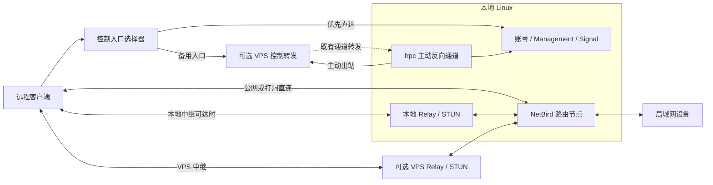

# NetGo 原生多平台接入与远程桌面：完整执行方案

2026-11-26 当前实现与必要验证见 [重构维护记录](REFACTOR_MAINTENANCE_2026-11-26.zh-CN.md)：连接/路由、平台生命周期、管理分页与定向认证存储按模块收敛，API v2/schema 4 不变。下文保留历次设计及完整验收目标，不能作为本轮已执行全套验收的证明。

版本：2.4。修订日期：2026-11-26（Asia/Shanghai）。当前源码：0.3.0-dev / API v2 / schema 4。服务端领域、Windows 单 NetGo.exe 与 GTK 查看器已实现部分功能；逐平台构建、签名、设备及交付退出条件分别记录，不将阶段包当成五平台全部完成。

本文保留历史设计与验收目标；其中历史阶段的“尚未实现”不作为当前代码状态。当前已实现范围以 [源码追踪](IMPLEMENTATION_MATRIX.zh-CN.md)、[统一契约](INTEGRATION_CONTRACT.zh-CN.md) 和 [当前维护记录](REFACTOR_MAINTENANCE_2026-11-26.zh-CN.md) 为准。

最新用户修订：五个原生客户端继续实现，macOS/iOS 已加入独立构建；签名与设备验收按实际环境登记。Windows、Linux 桌面、Android、macOS、iOS、LAN 服务端与 VPS 共七个独立构建入口，见 [独立构建说明](BUILD_CLIENTS.zh-CN.md)。服务端及节点维护统一 Go，不兼容旧 API/数据库；普通 Windows 用户只打开 NetGo.exe。

2026-11-24 接续：LAN/VPS 以新 schema 2 初始化受保护实验环境，维护采用 ng/ngv 菜单。旁路由互联网是按账号授权的独立资源。客户端使用通过 TLS 验证的服务端时间，不再以 30 秒本机时差拒绝连接。下文保留历轮设计与验收约束；实际命令和当前状态以 [运行维护](OPERATIONS.zh-CN.md)、[进度](PROGRESS.zh-CN.md) 为准。

v2.2 明确统一站点/账号/设备体验，分别维护站点会话、网络通道和远控会话的生命周期；增加跨模块退出、撤权、路径变化、失效恢复和包体门槛。详见 [统一集成契约](INTEGRATION_CONTRACT.zh-CN.md)，其中 I01–I10 是融合验收条件，不以模块单测通过代替。Windows 后续已将 DXGI 采集连接到编码、传输和远控授权；GPU 硬件编码后续已接入 Windows/macOS，当前边界见 [远控功能](REMOTE_HOST_FEATURES.zh-CN.md)。新增 [远控票据契约](REMOTE_TICKET.zh-CN.md)，Go 签发与独立 C++ 验签模块使用同一组样本；它们已接入 API v2 和 Windows 主机监听器。

同日增补：模块边界、最少必要依赖、发布体积预算、性能稳定性与可维护性成为每阶段检查项。已将 Windows 公共系统/配置/IPC 与连接后台分库，UI 不链接媒体/TLS 引擎；细则见 REMOTE_NATIVE_PLAN §6。清理只针对已确认过时的程序、重复构建/测试数据和停用数据库，保留正在使用的身份与最小恢复证据。最终提交到 GitHub main，核对分支独有提交后只保留 main；不以清理为由丢弃有效源码。

v2.1 执行修正：RD1a 先交付不依赖媒体 SDK 的纯 C ABI 会话门禁；RD1b 单独验证真实媒体与平台适配。RD2 领域/新库契约可在 RD1a 后推进，网络拓扑和媒体参数待真实原型冻结。最终只保留 v2/schema 2 实现，不建设旧接口兼容层或数据双写；v1 基线在切换完成后退役。任何门禁单测均不算远控功能或平台客户端已交付。

状态：接续会话 01a2075c-f461-7531-b0ff-0d0de8d06a52 的最终指令及远控分析会话 01a20765-97e3-7d70-8e5f-45cab955b105。保留现有 VPN 能力，新增远程桌面与各平台原生客户端；统一产品，模块按需启用。用户允许新数据库、新接口，不要求兼容旧开发数据。该阶段起点是 VPN 基线；目前远控媒体、移动端和 Apple/Linux 查看器已接入，设备验收仍有未完成项。新增工作的依赖、接口、文件位置及验收见 [远控与原生多平台实施方案](REMOTE_NATIVE_PLAN.zh-CN.md)。

本方案取代旧版 `ARCHITECTURE_PLAN.zh-CN.md` 的实施优先级；v1.9 以前的“其他客户端后续扩展”已由用户最新要求覆盖。控制服务仍在 Linux，VPS 仍只提供可选辅助；OpenWrt 和代理插件不进入当前交付；IPv4 互联网出口已按账号资源授权纳入实现。

### 本轮执行与审阅口径

原 VPN 交付按 E0–E5 收尾，新增工作按 RD0–RD6 推进。继承基线为 eb89241；该历史接续起点曾有未提交变更；本轮以已提交 main 为基线，最终状态见重构记录。先处理旧验证阻断并保存真实证据，再完成远控可行性原型、v2 契约、Windows、Android、Apple/Linux 原生端及统一交付。详细任务见 REMOTE_NATIVE_PLAN，未通过的媒体原型不得用界面或启动外部程序代替。

| 段落 | 工作与交付 | 完成判定 |
| --- | --- | --- |
| E0 方案与环境 | 核对完整方案、参考安装入口和现有主机状态 | 记录 Debian 13 LAN/VPS 与 Debian 12 历史环境、既有服务、支持范围和初始基线 |
| E1 独立安装入口 | 服务端 install-server.sh 与 Windows 客户端 install-client.ps1；菜单、校验、离线安装及卸载 | 两个独立脚本可分别审阅；无效参数、校验失败和归属冲突必须拒绝 |
| E2 Linux 部署闭环 | 固定依赖、原生 CGO 构建、首次配置与 systemd；修复真实运行缺陷 | 必需人工输入有明确提示；安装失败可诊断和恢复；不改写无关网络 |
| E3 实机验证与桌面完善 | Linux 安装/卸载/重装、认证/权限和真实隔离隧道；当前 Windows 的服务/连接；参照 ocserv-openwrt 紧凑分页界面 | 保存实际命令/结果；比对原有 SSH、Docker、防火墙与转发状态；窗口、菜单、配置表单和连接交互可用 |
| E4 完整自动验证 | 新代码和安装工具的回归、双平台构建、交付校验 | 验证日志与当前源码、二进制对应；不得沿用已过时摘要 |
| E5 文档与交付 | 同步文档、记录剩余环境验收、清理无效临时文件、推送 GitHub main | 脚本可下载；没有密码/私钥进入 Git；本地提交与远端一致 |

实时进度写入 `PROGRESS.zh-CN.md`；当前接续证据写入 `evidence/2026-11-23-continuation/`。`evidence/2026-11-22-installers/` 与 `evidence/2026-11-23-delivery/` 保留原测试范围和日期；最近失败与较早 PASS 同时记录。完整条款定位见 `IMPLEMENTATION_MATRIX.zh-CN.md`，不同系统、运行模式及源码指纹不能相互替代。

完成状态分开登记：**源码完成**表示约定范围已有实现且本轮已确认的阻断缺陷已修复；**自动验证完成**须有对应源码指纹、命令和实际结果；**真实验收完成**须有目标环境证据；**可发行**还须通过 P0–P4 的退出条件。替身、回环服务、脚本计划检查和交叉编译不能替代 LAN/NAT、systemd、跨用户安装或 72 小时验收。

当前产品目标：Debian 12/13 amd64 服务端；Windows C++/Win32、Android Kotlin、macOS/iOS Swift、Linux C++/GTK 原生客户端；保留 Go 诊断 CLI。共享远控核心与平台 UI 分离，先 Windows 被控端及 Windows/Android 控制端，再 Apple/Linux 平台闭环。移动端首先作为控制端，不承诺 iOS 无人值守整机控制。用户已授权连续实施、真实实验、清理和推送 main，阶段切换不重复等待确认。缺少 SDK、签名或设备只阻断相应验收，不把源码文件存在当成平台完成。

开发缓存、临时文件、运行副本和日志默认放在 `E:/NetGo/.cache`，不再向 C 盘安装测试程序。构建文件与运行副本分开；未变更的已运行二进制按摘要保留，变更的锁定文件必须明确失败，不停止未知进程、不跳过验证。测试站点及辅助端口见实验配置，SSH 密码不写入方案或提交。

v1.8 接续原会话的最后追加要求：当前 Windows 实际为 Windows 10 LTSC 1809 x64，也纳入兼容验证；Windows 11 独立登记。桌面主窗口改为 520×370 逻辑客户区，连接、VPN 信息、资源、日志分页；提供普通服务器编辑表单、密码显示、快捷键和按站点绑定的自动连接。真实 API 测试已经覆盖原生登录/刷新与账户策略；内核隧道、运维生命周期和最终构建继续逐项记录。

国内动态公网默认使用可配置高位端口（控制 10443、Relay 18443），VPS 独立选择高位端口或 443，保持同一 HTTPS authority/issuer。H3C MSR3610-X1-DP 的 2–3 条宽带由路由器处理拨号、NAT、连接保持和回程，NetGo 处理多候选与恢复；逐 WAN DDNS/地址文件边界见 `MULTI_WAN.zh-CN.md`。端口与多 WAN 行为均须按实际线路验证。

## 1. 产品目标与不可改变的要求

用户选择一台 Linux 服务器，填写管理员分配的账号密码，连接后访问获准资源，或在原生客户端内开启获准设备的远程桌面。账号、权限和必要控制服务均在这台 Linux 上。VPS 是可选增强组件；每台被控电脑须显式安装并启用主机组件。

| 编号 | 要求 | 完成证据 |
| --- | --- | --- |
| R01 | 单台 Linux 完成账号、设备授权、控制与局域网转发 | 一台 Linux 加一台远程客户端完成首次登录；无需另一台内网控制机 |
| R02 | 不配置任何 VPS，也能在公网入口可达时使用 | 清空客户端历史状态并屏蔽外部协调、中继地址，首次登录和重启重连成功 |
| R03 | 支持动态公网地址 | 地址更新后重新发现同一站点，无需新建账号或重复注册设备 |
| R04 | VPS 可选，提前配置后自动备用 | 本地公网入口消失但仍能出站联网时，经 VPS 访问本地认证和控制服务 |
| R05 | 优先建立可用直连，必要时中继 | 分别证明公网直连、NAT 打洞直连、VPS 中继；不只看界面显示 |
| R06 | 添加 VPS 不破坏单机独立性 | 添加 VPS 后将其完全关闭，新客户端仍能通过可达本地公网入口登录连接 |
| R07 | 账号密码在客户端窗口输入 | 真实用户、设备、权限对应正确，不用共享设备注册密钥代替用户登录 |
| R08 | 局域网设备无需安装客户端 | Linux 转发到普通 NAS、电脑或其他设备；默认无需调整其回程路由 |
| R09 | 权限由 Linux 执行 | 未授权网段、账号封禁、账号过期和旧会话回收均实测阻断 |
| R10 | 只转发获准的局域网流量 | 默认不改客户端互联网出口；管理服务和用户之间默认不可互访 |
| R11 | 部署和卸载可恢复 | 不覆盖主机现有整套防火墙；能备份、升级、回退、卸载受管规则 |
| R12 | 清楚显示可达性和失败原因 | 区分登录入口、数据路径、目标设备问题；无可用路径时明确报错 |

“有公网 IP”指所需入口实际可达：可以是 Linux 直接拥有公网地址，也可以是上级路由器把公网端口映射给 Linux。公网 IPv6 仅在两端存在可用 IPv6 路径时才有意义。

没有预先配置 VPS、也没有其他可用直达入口时，失去公网后不保证远程重新接入。本地断网或关机时，中继无法代替本地提供局域网服务。这里的“独立运行”是不依赖外部控制/中继，并不等于永远不需要 DNS、校时或证书续期。

新增强制要求：R13 统一产品及独立远控权限；R14 Windows/Android/Apple/Linux 原生 UI；R15 共享 C ABI 核心及平台适配；R16 新设备拓扑与主机侧授权撤销；R17 新 API/数据库且不自动清除旧状态；R18 可构建、可签名、可安装的分平台交付；R19 项目目录测试与有证据的清理。逐项验收见 REMOTE_NATIVE_PLAN §2、§8。

## 2. 当前交付范围与默认假设

这些默认值用于让开发可以开始，均须写入配置或兼容性清单，后续可依据实测调整。

| 项目 | 第一版确定范围 |
| --- | --- |
| Linux 服务端 | Debian 12/13，amd64；当前 LAN/VPS 实机为 Debian 13，Debian 12 保留历史结果 |
| 用户客户端 | Windows 10 LTSC 1809/11 x64；Android Kotlin；macOS/iOS Swift；Linux GTK；Linux CLI 用于诊断。各目标需独立构建/设备证据 |
| 网络范围 | 既有 IPv4 LAN 资源；新增注册被控设备的 overlay 连接与单独策略，不能默认所有 peers 互通 |
| 客户端会话 | 同时连接一个站点；不同站点的凭据、密钥、缓存和配置分离 |
| 路由 | 分流，只把获准 LAN 网段/主机送入隧道；默认 Masquerade/SNAT |
| 账号 | 单一本地身份来源；短用户名作为别名，映射稳定用户 ID |
| 并发策略 | VPN、远控观看、远控控制分别计数；默认每账号一个 VPN 接入、每主机一个控制者。主机常驻身份不占用人的 VPN 登录配额 |
| 冲突策略 | 已有会话时默认拒绝新会话，用户明确选择“替换旧连接”后才替换 |
| 域名 | 管理员提供可控制的域名；权威 DNS 不部署在唯一可选 VPS 上 |
| VPS | 可完全不配置；配置时先支持一台、一对一关联一个站点 |
| 地址变化 | DDNS 更新直达候选；备用入口及站点信任信息随配置预先保存 |
| 安装形态 | 单机安装包，内部由多个 systemd 服务组成；不要求用户管理容器 |
| 验证规模 | 两个用户、两台客户端起步；交付前覆盖十个并发会话的实验负载 |

暂不交付：OpenWrt、二层桥接、广播自动发现、客户端互联网出口、透明代理、多个站点同时连接、多租户共享 VPS、多控制节点多活，以及 iOS 无人值守整机被控。Android/iOS/macOS/Linux 原生客户端已进入当前路线，不再列为范围外。

局域网访问按 IP 或配置的域名进行；“NAS 自动出现在网络邻居”“广播发现摄像头”不是三层路由验收的一部分。客户端与远端 LAN 网段重叠时，第一版检测并阻止含糊路由，提供改网段或显式单主机资源的处理说明；不隐式实施地址转换。

## 3. 技术选型与复用原则

| 层次 | 选择 | 实施边界 |
| --- | --- | --- |
| Linux 服务端、诊断 CLI | Go | 身份、会话、策略和运维；按锁定版本要求选择 Go 工具链 |
| 管理页面 | TypeScript + Vue 3 + Vite | 静态资源内嵌到 Go 服务；提供中文管理流程 |
| Windows 界面和产品后台 | C++20 + Win32 原生控件 | 普通权限 UI / netgo-agent；特权隧道操作由独立 NetBird 服务完成 |
| 其他原生 UI | Kotlin / Swift / C++ GTK | Android VpnService、Apple Network Extension、Linux 隧道服务与媒体核心分别适配 |
| 共享远控核心 | C++ 核心 + 版本化 C ABI；先验证窄系统媒体适配，再与 MiniRTC 候选比较 | CrossDesk 参考桥接与媒体集成；Aspia 参考主机服务/权限；未过 RD1 不引入发行依赖 |
| 网络核心 | NetBird 客户端、Management、Signal、Relay/STUN | 固定版本，以独立进程和公开接口集成，必要修改集中成补丁 |
| 用户身份 | 优先 NetBird 内嵌 Dex | 单一密码库；原生窗口认证列入 P0 必过门槛 |
| 局域网转发 | NetBird Networks / Routing Peer | Linux 开启转发，使用上游网络策略和 Masquerade |
| 备用控制通道 | frpc / frps | 只转发认证、管理、信令等控制请求；VPN 数据中继使用 NetBird Relay |
| TLS 控制入口 | Caddy | 认证、管理、信令和 NetGo API 分流；要求 HTTP/2、gRPC 与必要的 WebSocket 支持 |
| TCP 443 复用 | HAProxy TCP 模式 | 仅在 443 兼容模板启用，按 SNI 分流，保留到本地控制服务的 TLS |
| NetGo 元数据 | SQLite | 只保存站点、别名、会话、限额和审计关联；不直接写 NetBird 数据库 |
| 服务管理 | systemd | 依赖、自动重启、权限、日志、升级和状态诊断 |

NetBird 提供内嵌身份、独立 Relay/STUN、路由节点与受权 daemon RPC；frp 提供反向控制转发。Windows 产品代码全部采用 C++20：Win32 窗口、当前用户 SID 命名管道、Credential Manager、OpenSSL Ed25519/PKCE/TLS。上游网络核心继续用其原始 Go 实现，通过有界 JSON stdin/stdout 命令转接已有 RPC。设计见 ADR-0002；组合网络行为仍以实测为准。

选型规则：

1. 首选保留完整 NetBird 协议链，不把 DERP 地址当作 NetBird Relay 使用。
2. 第一版不同时维护 NetBird、Tailscale 两个后端。
3. 若 P0 出现明确架构阻碍，再使用同一套验收比较 Tailscale + Headscale；不得以换核心回避本地认证和入口切换问题。[S10]
4. 不修改 WireGuard 密码算法，不自行实现 NAT 穿透协议或中继协议。
5. 不把 NetBird 内部 Go 包当成稳定 SDK；优先进程接口，生成 RPC 客户端时使用与 daemon 一致的 proto。[S05]
6. 原 ocserv-openwrt 只参考账号、服务器列表、日志、重连和安装恢复等流程；不迁移其 OpenWrt 脚本或 OpenConnect 协议层。[S11]

所有发行物使用精确 tag、commit 或 SHA-256。Go、Node、C++ 工具链、OpenSSL、JSON 和 Vue 纳入 upstream/versions.lock.json；Go/npm 分别由 go.sum/package-lock.json 锁定传递依赖。main/dev 仅为能力参考，不能作为构建输入。

当前实现基线：NetBird v0.83.2、frp v0.72.0、Caddy v2.11.9、Go 1.27.4、Node 26.13.1、GCC 16.1.0、OpenSSL 4.1.0、nlohmann/json 3.12.0、Vue 3.5.46。已核实官方稳定发布；TypeScript 采用与 vue-tsc 兼容的 6.0.3，7.0.2 的不兼容原因保留。Dex 使用 NetBird 原锁定 fork。Wails 已移出产品依赖。HAProxy 由 Linux 包管理器提供，安装前记录实际版本，当前主机未执行其 Linux 运行验收。

## 4. 部署架构

### 4.1 本地 Linux：始终具备完整能力

| 服务 | 职责 | 是否始终需要 |
| --- | --- | --- |
| netgo-server | 配置、管理 API、账号别名、会话和审计 | 是 |
| NetBird Management + embedded IdP + Signal | 用户/设备身份、密钥、策略和连接协商 | 是，同一本地实例 |
| NetBird daemon | Linux 路由节点、隧道、LAN 转发 | 是 |
| 本地独立 Relay/STUN | 单机时的候选发现和本地中继能力 | 是，与可选 VPS 无关 |
| 本地 TLS 网关 | 统一站点身份，转发 HTTPS/gRPC | 是 |
| netgo-privileged-helper | 有限的规则、租约门禁与服务操作 | 是；不提供任意命令执行接口 |
| frpc | 主动连接可选 VPS | 仅启用辅助节点时 |
| HAProxy | 443 兼容模板的 TLS/SNI 分流 | 该模板启用时 |

**特意保留本地独立 Relay/STUN。** 上游 combined 的外部 Relay 配置会关闭内嵌 Relay/STUN。[S02][S03] 因此从 P0 起就将本地 Relay 作为独立进程列入服务地址列表；添加 VPS 只增加远端地址，不能只留下 VPS 地址。这里的“独立进程”仍在同一台 Linux 上，不增加服务器。

同一站点的本地/外部 Relay 鉴权 secret 与 Management 下发配置保持一致，并纳入受保护备份和轮换验证。[S02] Relay 凭据有效期不能代替用户会话租约；即使中继凭据仍有效，过期用户也必须在 Linux 网关被阻断。第一版不共享一个 Relay 实例给互不信任的多个站点。

本地中继的数据不经过外部 VPS；客户端可在 UDP 直连受限、但本地 TCP 中继入口仍可达时使用它。能否选中和恢复必须按锁定版本测试，界面要将“本地中继”与“公网直连”区分显示。

### 4.2 可选 VPS：只承担辅助角色

| 服务 | 职责 |
| --- | --- |
| NetBird Relay/STUN | 公网映射发现与加密 VPN 数据中继 |
| frps | 接收 Linux 主动连接，形成到本地控制入口的反向通道 |
| HAProxy（443 模板） | 按 SNI 区分控制转发、Relay 和 frp 通道 |
| 运维配置 | 限制转发端口、连接数、日志和证书管理 |

VPS 不保存第二份用户密码库，不运行另一套活动 Management 数据库。控制请求的 TLS 终止于本地 Linux；VPS 自己只持有 Relay/frp 域名所需密钥。VPS 仍可看到连接地址、时序和流量大小。

**只需零台或一台 VPS，不需要为 FRP 和 Relay 分别准备两台。** 一台可选 VPS 同时运行 frps、NetBird Relay/STUN；443 模式再运行 HAProxy。示例中的 VPS 地址、relay.aux.example 和 tunnel.aux.example 可以指向同一个公网 IP，它们按端口或 SNI 区分服务。

FRP 本身能转发 LAN 的固定服务端口；如果需求仅为开放少量固定 NAS/SSH 服务，单用 FRP 是另一种可行产品范围。本方案保留 VPN 网段/资源权限、直连优先与自动恢复：FRP 负责备用控制入口，NetBird Relay 负责直连失败后的 VPN 数据。业务数据选择直连或 Relay，不再经 FRP 串联转发。

```text
登录/控制备用：客户端 → VPS 的 frps → Debian 的 frpc → 本地认证/控制
业务优先路径：客户端 ↔ Debian → 获准 LAN 设备
业务备用路径：客户端 ↔ 同一台 VPS 的 NetBird Relay ↔ Debian → 获准 LAN 设备
```

frpc 到 frps 的待命通道由 Debian 主动建立。无 VPS 模式仍由本地完整控制服务和本地 Relay/STUN 工作，可用性取决于本地入口实际可达。

### 4.3 控制路径与数据路径分开



控制走 VPS、数据打洞直连，以及控制直达、数据经中继，都属于允许的状态。数据路径由连接核心选择；NetGo 的入口选择器负责认证/管理/信令，不另起一套 ICE 引擎。

## 5. 站点身份、地址与入口切换

### 5.1 一份身份，多种到达地址

每个站点保存不可随 IP 变化而改变的 site_id、规范控制域名、OIDC issuer、信任配置和设备归属。示例规范域名为 control.site.example；示例域名只表达角色，不能直接用于部署。

| 字段 | 用途 |
| --- | --- |
| canonical_control_host | TLS SNI、HTTP authority 和逻辑身份 |
| oidc_issuer | 全流程一致的签发者；具体路径以锁定版本为准 |
| direct_candidates | LAN 地址、DDNS A/AAAA、直接公网地址和对应端口 |
| auxiliary_candidates | VPS 的稳定地址/域名与控制转发端口 |
| relay_endpoints | 本地与可选 VPS 的 Relay 列表 |
| stun_endpoints | 本地与可选 VPS 的 STUN 列表 |
| config_revision | 配置版本；更新须经过身份验证且可回退 |

客户端拨 VPS 的 TCP 地址时，仍校验本地站点的证书和 SNI，不把 issuer 改成 VPS 域名。服务端自己读取 discovery/JWKS 时，也必须能通过本机内部路径到达同一身份服务。

导入文件包含站点身份、公钥/证书信任、候选和版本，不包含密码、私钥、Relay 共享密钥或管理令牌。初次导入需可信渠道或人工核对站点身份；后续候选更新通过已认证通道取得。缓存 IP 只能作为候选，证书/站点校验仍必须成功。

0.2.2-dev 将配置版本实现为 Site.ConfigRevision（0 为旧开发文件，1 起版本化）。每次原生登录成功后从受认证 /site 同步，校验身份/版本、探测可达性后保存；连接期间保留本次快照，新候选在下次连接生效。服务器配置回退以更高版本发布旧内容，避免客户端防回退检查阻断恢复。既有候选的动态 DNS 与故障切换仍持续执行。

### 5.2 控制入口选择器

将选路封装为各客户端的统一传输组件：Windows 使用 C++/OpenSSL，Linux CLI 使用 Go，NetBird gRPC/Signal 使用固定上游补丁。覆盖 HTTP、认证/刷新、Management gRPC、Signal 及实际使用的 WebSocket。服务端通过本机路径访问同一 issuer 的 discovery/JWKS/token。只改 gRPC 不能算完成。

建议初始参数：

| 项目 | 初始值 | 说明 |
| --- | --- | --- |
| 启动备用候选延迟 | 800 毫秒 | 直达尚未完成时，并行探测已配置的备用入口 |
| 单候选 TCP/TLS 探测上限 | 3 秒 | 明确网络可达与服务身份，不串行等待多个长超时 |
| 登录前选路总预算 | 10 秒 | 超时返回可操作原因；认证本身另设超时 |
| 重试退避 | 1、2、4、8 秒，最大 30 秒，带抖动 | 网络恢复后主动重试 |
| 直达恢复确认 | 3 次探测成功，间隔 5 秒 | 避免公网抖动时反复迁移 |
| 切换冷却 | 30 秒 | 已有路径失效可立即切换；健康路径不频繁搬迁 |

参数是设计起点，需通过测试调整。健康探测不得提前发送用户名、密码或有副作用的注册请求；先选定并验证入口，再执行写操作。登录、注册、替换会话使用幂等键，不能因重试产生重复设备或踢掉新会话。

0.2.3-dev 的上游 gRPC 适配保留候选类别，使用并发 TLS/HTTP2 探测、800 毫秒备用延迟、每候选 3 秒上限及取消清理，避免多个卡住的入口串行耗尽登录预算。已建立的健康 gRPC 流由上游维护，HTTP 入口选择器发现直达恢复并不强制重置该流；新建或断线重拨重新选路。Linux 诊断客户端复用唯一的当前用户 profile，并在租约授权后等待异步资源路由（最多 15 秒且可取消）；只有完整授权路由选择成功才继续显示连接状态。

系统浏览器不会使用自定义 Go 拨号器。因此 P0 可用标准浏览器认证验证底层，正式原生登录必须覆盖所有 HTTP/OIDC 请求。管理网页的浏览器访问另行说明：公网不可达时优先从已连接的受权管理通道访问；不把浏览器自动故障切换当成已实现功能。

### 5.3 地址变化与反向通道

1. 服务端监测接口、默认路由和外部地址变化；按网络事件触发检查，并以低频定时检查补漏。
2. 公网变化时更新独立 DNS 服务中的 A/AAAA，撤掉失效候选。IPv4 和 IPv6 分开判断。
3. 配置 VPS 后保持 frpc 待命；WAN 变化或通道断开后主动重建，与用户 VPN 无关。
4. NetBird 核心重新收集候选、协商数据路径；公网恢复时重新检查可用直连。
5. 直达候选发布不能依赖唯一 VPS 查询接口；VPS 全停后仍能独立更新 DDNS。

Linux 位于上级路由器后时，不能只向本机 STUN 查询就假定发现了正确公网映射。P0 要验证固定 UDP 端口、上级映射及上游 external-ip-map 能否发布正确候选，并在 DDNS/IP 改变时同步更新。[S22] 如果公网映射改变了端口，需验证上游支持的发布方式或限制为同端口映射；不发布未经验证的 IP/端口组合。

Linux 本机访问自己的控制域名、本地 Relay/STUN 时，必须配置内部解析或受控拨号映射，避免依赖路由器 hairpin NAT。不得把修改远程客户端的全局 hosts 文件作为正式方案。

### 5.4 状态机与恢复语义

控制状态：未连接 → 探测 → 直达控制/备用控制 → 认证 → 已授权 → 恢复中。

数据状态：协商中 → 直连/本地中继/VPS中继 → 恢复中 → 不可达。

每次连接有递增 generation。用户取消、切换站点或退出后，上一 generation 的迟到回调不得重建连接。UI 分别显示控制入口与数据路径；调试界面显示 Relay 和 WS/QUIC 类型。

尽量保持虚拟地址、设备密钥和目标地址不变，以利应用恢复；不承诺每个 TCP 会话在所有切换中都不会断开。公网彻底失去且没有辅助节点时，返回“无可用入口”，不无限显示正在登录。

## 6. 账号认证、设备注册和会话控制

### 6.1 认证适配必须先验证

NetBird 内嵌身份服务能管理本地用户，但本次核对的 daemon.proto 中 LoginRequest 不包含用户密码参数，WaitSSOLogin 仍围绕 SSO 流程。[S01][S06] 不能把一个账号密码输入框直接接到该 RPC 上，就宣称实现了登录。

P0 分两步执行：

1. 用上游标准认证建立基线，验证用户归属、设备注册、LAN 策略和控制服务部署。
2. 阅读锁定版本的 IdP 与客户端认证实现，形成原生认证 ADR 和协议测试，再实现最小原型。浏览器基线不计入 R07 完成。

首选原型设计：在同一内嵌 IdP 的认证边界增加受控的原生认证适配，调用既有密码验证、用户状态和标准令牌签发流程；在客户端为该结果增加最小本地 RPC 适配。它属于待验证的补丁方案，不假定上游已提供公共接口。

要求：

- 只保留一份密码来源，禁止 NetGo 复制 IdP 密码哈希或直接修改其数据库。
- 令牌仍来自受信的同一 issuer，Management 验证真实用户；不发所有用户共用的 setup key。
- 先创建短时认证事务，绑定站点、客户端 profile、设备公钥摘要、nonce 和 PKCE challenge，再在已验证 TLS 内提交密码。
- 设备归属必须结合上游已验证的注册/密钥持有结果；不能仅相信请求体中的 peer_id 或公钥文本。原生认证与网关门禁之间的绑定列入攻击性测试。
- 返回只能使用一次、短时有效的授权结果，兑换时验证 PKCE、设备绑定和用户状态。初始事务有效期建议 60 秒；密码验证成功不直接代表 LAN 权限已开启。
- 非标准“原生认证入口”只能称为本项目接口，不能声称是标准 OIDC 新增密码授权；不开放通用 password grant。
- 不能靠抓取登录 HTML、模拟表单或在 WebView 中绕过认证限制作为长期方案。
- 禁用账号、密码重置、会话撤销必须使产品凭据和 Linux 租约失效；在途密码验证也受认证代次约束。密码维护调用同一 IdP 的原生管理命令。标准 OIDC 已签 JWT 遵循上游有效期，不能仅凭密码已改就宣称全部既有 JWT 立即吊销；LAN 拒绝由 Linux 门禁保证。

如果无法在既有身份服务内建立可维护的适配，先形成替代 ADR，评估以单一本地 OIDC 服务替换身份来源，并验证 NetBird 的接入方式。不能临时新增第二个密码库或放松 R07；此门槛未通过，不启动完整 UI 产品化。

### 6.2 推荐登录与连接顺序

1. 客户端读取站点配置，探测并验证控制入口。
2. 创建或读取该站点的本机设备身份；私钥不上传。
3. 用户在原生界面提交账号密码，取得真实用户授权。
4. 向本地控制服务注册/恢复设备；同一设备重试保持幂等。
5. 服务端检查账号有效期、设备限额、资源权限和并发会话。
6. 原子取得会话租约，将 user_id、peer_id、公钥与虚拟地址的可信绑定交给网关门禁。
7. 网关确认策略与租约生效，才允许到获准 LAN 的流量；客户端进入数据协商。
8. UI 只有在资源路由生效且会话有效时才显示可用。目标设备不响应单独显示诊断，不混同登录失败。

Linux 路由节点自身可以使用单独的管理用途注册凭据；该凭据不提供给普通用户，不混入用户会话模型。

### 6.3 会话租约与强制撤销

元数据建议包含 Site、UserAlias、DeviceBinding、SessionLease、Resource、AccessPolicy、AuxiliaryNode、AuditEvent。用户密码仍由 IdP 保存。

| 对象/规则 | 初始设计 |
| --- | --- |
| 用户 ID | 引用 IdP/Management 的稳定 ID；短用户名只作别名 |
| 设备绑定 | site_id + user_id + peer_id + 公钥摘要；由服务端确认，不能信任客户端自报归属 |
| 有效会话 | 每账号默认一个，数据库唯一约束或事务加锁保证 |
| 租约 | 初始 120 秒，客户端每 30 秒通过受认证控制通道续租 |
| 网络恢复 | 租约内使用同一 session_id 恢复，不另占一个在线名额 |
| 替换旧会话 | 撤销旧门禁并清理必要连接状态，确认成功后开启新门禁 |
| 过期/封禁 | 不再续租，立即发起本地撤销；过期时间硬性限制最长租期 |
| 管理服务故障 | 已授权会话最多使用到租约到期，随后停止 LAN 访问 |
| 重启恢复 | 默认拒绝旧门禁，重新校验账号和绑定；不无限恢复旧会话 |

为保证非合作客户端也会断开，在 Linux 上增加最小的租约门禁：以受验证的 peer/虚拟源地址绑定为依据，用带超时的 nftables 集合限制访问。它只做附加的拒绝和租约检查，资源范围仍由上游策略执行。

P0 必须证明门禁先于可能放行的连接跟踪规则生效，并阻止已建立 TCP/UDP 流；按该会话范围清理 conntrack，不能清空全机连接。禁用对受管隧道流量的 flow offload 或验证其不会绕过撤销。必须测试伪造其他虚拟源地址无法绕过设备绑定。若 nftables 路径不可满足，重新设计门禁/撤销方式，不能把“让客户端自行断开”当作替代。

### 6.4 凭据与管理权限

- 密码只在一次认证所需时间内处理，不写日志、命令行、诊断包或持久配置。
- Windows 默认不记住密码；用户勾选后使用当前用户 Credential Manager，按站点隔离。设备 Ed25519 seed 也存入该系统库。会话令牌及刷新令牌仅在后台内存；Linux 诊断 CLI 使用权限受控文件。站点和诊断导出不含秘密。
- 管理页面与普通用户连接分离权限；初始管理员只能通过本机初始化或受限 LAN 引导创建。
- 新用户默认没有 LAN 权限，显式加入资源组后可用；移除任何默认全员互通策略。
- 认证限流按账号、站点和可信网络信息组合；经四层反向通道后不能把所有用户都误认成 Linux/VPS 单一源地址，也不信任用户自带转发头。

## 7. 局域网转发、DNS 和权限

示例：Linux 为 192.168.50.10，NAS 为 192.168.50.20，远程客户端虚拟地址由上游分配。

```text
客户端访问 192.168.50.20
  → 命中下发的资源路由
  → 经加密隧道抵达 Linux
  → 会话租约与资源策略验证
  → SNAT 为 192.168.50.10
  → NAS 回复 Linux
  → Linux 反向 NAT 并通过隧道回复客户端
```

Linux 使用 NetBird Routing Peer 的转发与 Masquerade。关闭 Masquerade 时，需要在目标设备或其默认网关配置通往 VPN 地址池的回程路由；第一版默认保持开启。[S04][S12]

实施步骤：

1. 识别 LAN 网卡、地址与路由，检查 Linux 到目标设备服务端口是否本来就可达。
2. 显式创建网络资源：例如整个 192.168.50.0/24，或只开放 192.168.50.20/32 的指定端口。
3. 将 Linux 设为 Routing Peer，开启该资源的 Masquerade。
4. 下发用户组到资源的最小权限策略，默认禁止客户端互访和访问 Linux 管理接口。
5. 验证内核转发和主机防火墙；上游规则与 NetGo 租约规则分别管理，记录对象归属。
6. 客户端确认资源路由安装成功；未获准路由不启用。
7. 若需要名称访问，再配置指定后缀的 split DNS；IP 访问是最小交付基础。

LAN 设备的系统登录、共享权限和服务防火墙仍然有效；VPN 账号授予网络可达性，不代替 NAS、SSH 或远程桌面自己的账号。

防火墙验收必须分别覆盖 INPUT（访问 Linux 自身）和 FORWARD（经 Linux 访问 LAN）。不能为了放通 LAN 把 Linux 所有管理端口同时开放。不能自动 flush 现有 nftables/iptables，安装器只创建和撤销带归属标记的对象。

客户端与服务器的控制、Relay、STUN 和 frp 连接保留物理网络路径，避免控制连接被资源路由绕回用户 VPN。overlay 地址池、客户端本地网段、目标 LAN 和运营商 CGNAT 地址均纳入冲突检查；不硬编码一个所有场景都适用的虚拟网段。

第一版内网资源限定 IPv4；承载隧道的公网路径允许 IPv4/IPv6，分别测试。IPv6 内网资源后续单列支持，避免只配置 IPv4 门禁却误放行 IPv6。

## 8. 端口、证书和两种部署模板

以下是本项目建议端口，不是所有上游的固定默认值。安装前检查冲突，最终端口由生成配置和验收结果确定。直连数据 UDP 端口必须核实实际绑定及公网映射；不能仅打开端口却发布错误候选。[S13]

### 8.1 易诊断模板：P0 起步

| 位置 | 端口 | 用途 |
| --- | --- | --- |
| Linux | TCP 10443，可调整 | Caddy，本地认证/管理/信令入口；新站点默认高位端口 |
| Linux | TCP/UDP 18443，可调整 | 独立本地 Relay，分别 WS/QUIC |
| Linux | UDP 3478 | 本地 STUN |
| Linux | UDP 51820，可调整 | Linux 路由节点的固定数据端口；公网映射必须对应 |
| VPS（可选） | TCP/UDP 28443，可调整 | 外部 Relay；可单独选择 443 模式 |
| VPS（可选） | UDP 3478 | 外部 STUN |
| VPS（可选） | TCP 27000，可调整 | frps 接收 Linux 的主动 TLS 通道 |
| VPS（可选） | TCP 24443，可调整 | frps 暴露的控制转发入口，原始 TLS 透传至 Linux |

该模板用于一般网络和排错，不宣称覆盖“只允许 TCP 443 出站”的环境。

控制端口取自 Site.Origin，内部服务端口取自 Listen/ManagementURL；Deployment.LocalRelayPort/LocalSTUNPort 配置本地服务。辅助节点从 Relay、STUN、ControlPort、TunnelPort 取得端口，默认示例不要求 443。公网端口映射与候选 Address 必须对应；外部映射端口可以与本地监听不同，逻辑 authority/issuer 不随物理候选切换。生成器输出 deployment.json 记录端口和文件摘要，并拒绝冲突、错误 SNI 和不一致的备用候选。

### 8.2 可选 TCP 443 兼容模板

Deployment.Mode 控制本地模式，Auxiliaries[].Mode 独立控制 VPS 模式。国内本地入站 443 受限时，可保持本地 diagnostic 高位端口，仅将可用 VPS 配为 443。A10 验证受限出站环境通过 VPS 的兼容能力，不要求本地宽带必须开放 443；无 VPS 的可用性依赖实际可达的本地入口。

Linux 的公共 TCP 443 由 HAProxy TCP 模式接收：

- SNI=control.site.example → 本机 Caddy TLS 入口 → 本地控制服务。
- SNI=relay.site.example → 本机独立 Relay 的 TLS/WS 端口。
- 公共 UDP 443 独立转发至同一 Relay 的 QUIC 监听端口；不由 TCP SNI 规则处理。

VPS 的公共 TCP 443 同理：

- SNI=control.site.example → 只绑定回环的 frps 控制转发端口 → frpc → 本地 Caddy。
- SNI=relay.aux.example → VPS Relay。
- SNI=tunnel.aux.example → frps 的 TLS 通道入口。
- 公共 UDP 443 → VPS Relay QUIC；UDP 3478 → STUN。

HAProxy 的 TCP/SNI 能力、Caddy 的 gRPC 反向代理、frp 的 TLS 设置可作为实现基础。[S14–S16] 本拓扑是组合设计，必须实测 HTTP/2、长连接、WS、QUIC 和证书更新。未知 SNI 直接拒绝。Caddy 不占用公共 UDP 443；禁止自动 HTTP/3 监听与 Relay 冲突。

frpc 在此模板使用标准 TLS ClientHello 和正确 serverName；核对 disableCustomTLSFirstByte、证书验证、frps 监听及鉴权配置。[S16] 所有映射只允许预定端口，避免把 frps 变成任意端口转发服务。

Relay 的 TLS 保持在 Relay 进程终止，不使用会破坏其 QUIC 路径的统一 HTTP TLS 终止代理。[S02] 公共 UDP 无法使用时，应验证 WS/TCP 443 仍能承载中继和控制通道；仅测试 UDP 阻断、不测试非 443 TCP 阻断，不足以证明此模板通过。

### 8.3 域名与证书生命周期

建议 DNS-01 颁发/续期，让本地失去公网入口后仍可通过 DNS 服务更新证书；DNS 凭据限制到所需区域。证书留在各自 TLS 终止节点，控制域名私钥不复制到 VPS。

HTTPS 证书按域名校验，不绑定 443。当前模板使用显式证书文件，关闭自动 HTTP challenge/HTTP3 监听。运维入口为外部 Certbot + DNS provider 插件完成 DNS-01，再调用 deploy/linux/deploy-certificate.sh 验证域名、有效期与密钥配对，更新证书并重载/重启对应活动服务；失败恢复原文件并保留受保护事务目录。第一版说明 Cloudflare 接入，其他 provider 须另行验证。ACME 客户端和插件由目标 Linux 提供，须记录实际版本后验收；本轮没有真实签发/续期结果。

所选 DNS provider 的证书模块/客户端也纳入版本和构建清单；P0 在真实 DNS 区域验证 TXT 更新权限、续期及重载。不能把“配置 DNS-01”当作已经验证所有 DNS 厂商均支持。[S15]

实验室可使用受信任的私有 CA，但必须显式导入信任，不能关闭证书校验。证书、身份签名密钥、数据库加密密钥、DNS 凭据分开保存和备份。证书续期失败提前告警，不在证书过期后静默跳过验证。

## 9. 模块、数据和接口契约

### 9.1 当前代码目录与职责

```text
cmd/netgo-server/             本地产品服务
cmd/netgo-client-service/     Linux 诊断客户端（不构建 Windows 版本）
cmd/netgoctl/                运维与诊断 CLI
cmd/netgo-helper/            Linux 受限权限门禁
cmd/netgo-ddns/              Linux DDNS 进程
internal/site/               站点身份与配置
internal/controlpath/        多入口探测、传输和重试
internal/identity/           单一身份服务适配
internal/accounts/           账号领域服务与上游账号协调
internal/store/              SQLite 事务、索引查询与审计分页
internal/engine/netbird/     daemon RPC 与管理 API 适配
internal/session/            并发、租约和撤销
internal/gateway/            Linux 转发与权限协调
internal/privileged/         有限权限 helper
internal/ddns/               地址探测和 DNS 更新
internal/diagnostics/        日志脱敏与诊断包
internal/operations/         配置变更、发行校验与升级/回退事务
internal/securefile/         受保护文件的原子写入
apps/ui/                     Vue Linux 管理页面
apps/windows/                C++20 原生界面、后台、协议和验证
apps/android/                Kotlin UI、VpnService、JNI 查看器
apps/apple/                  Swift macOS/iOS、Network Extension、ObjC++ 查看器
apps/linux/                  GTK 桌面控制端；Linux 被控主机适配尚未实现
packages/remote-core/        C ABI、票据验证、会话/输入门禁
packages/remote-client/      跨平台远控查看器与会话控制
packages/remote-transport/   认证传输与有界媒体发送
internal/remote/             主机、授权、远控租约和审计
packages/ui/                 浏览器管理认证与类型契约
deploy/linux/                systemd、安装和升级
deploy/templates/auxiliary/  VPS Relay/frp/443 模板
deploy/windows/              Windows 安装和卸载
upstream/                    版本锁、补丁清单和重基记录
internal/*/*_test.go          服务与权限行为测试
tests/frontend/              浏览器认证测试
tests/network/               网络故障实验
docs/adr/                    关键决策
docs/evidence/               测试环境和脱敏证据
```

### 9.2 接口边界

下表为本项目实现的接口边界，NetBird REST/gRPC 保持独立。所有远端受保护请求均含短期令牌、设备签名、时间和防重放 nonce。

| 接口类别 | 当前契约 | 约束 |
| --- | --- | --- |
| 公共探测 | GET /netgo/v2/health | 只暴露最少健康信息，不返回拓扑、账号和密钥 |
| 站点信息 | GET /netgo/v2/site | 认证后返回站点身份、控制候选与版本化配置 |
| 原生认证 | POST /netgo/v2/auth/transactions，及对应完成/兑换动作 | 第 6 节约束；由 IdP 边界处理，不能自己伪造上游令牌 |
| 会话 | POST /netgo/v2/sessions；续租、撤销、替换动作 | 用户/设备绑定、generation、幂等键、并发事务 |
| 管理 | admin/state、users（创建/更新/删除）、devices（删除）、resources（更新/删除）、sessions（撤销）、reconcile | 管理角色；最后管理员不能删除；辅助节点通过 CLI/模板配置；不暴露上游令牌 |
| 管理审计 | GET /netgo/v2/admin/audit，使用 before 游标分页 | 每页最多 100 条；响应 events、next_before；admin/state 不加载审计历史 |
| 远控 | /netgo/v2/remote、remote/host、remote/sessions、admin/remote/grants | 路由与权限见 REMOTE_NATIVE_PLAN §4；授权响应包含 site_key；当前仅 Windows 本地同意主机与观看/输入/音频能力 |
| 配置校验 | validate → plan → apply | 先验证并产生变更计划，失败回滚 |
| Windows IPC | status、profiles、import、connect、disconnect、logs、diagnostic、credential-info、forget、delete、shutdown | 当前用户 SID 命名管道；4 字节长度 + 有界 UTF-8 JSON；验证服务端身份；无 TCP 监听/任意命令 |
| helper IPC | POST /apply（仅本地 IPC） | 接收完整有效租约集合；最多 1024 条且 JSON 不超过 1 MiB；固定操作，无任意 shell 字符串 |

上游 RPC 的 schema 和权限需要按锁定版本核对；不要开放无认证本地 TCP API，也不要假设后台服务天然能代表所有桌面用户操作 profile。[S05]

### 9.3 数据持久化和配置所有权

- NetGo、NetBird 管理、IdP 各自保存其权威数据；通过 API/适配层联动，不跨库直接写表。
- NetGo 元数据存储上游对象 ID、desired_revision、observed_revision 和错误，协调任务重试后达到期望状态。
- Linux 的网络规则、systemd 单元和配置文件带 NetGo 所有权清单；现有第三方对象不可擅自覆盖。
- 客户端保存服务器配置、设备私钥、受保护刷新凭据、上次可用候选；日志不包含完整 token。
- API 需要协议版本和能力协商；不兼容时明确拒绝并提示升级，不盲目尝试写入旧格式。

当前源码统一使用 `/netgo/v2`、协议 2 与 schema 4，不维护旧接口、双写或旧数据库自动迁移。主机/授权/票据/设备绑定、持久 nonce、分表事务与正反/并发测试已实现。实际切换仍须完整归档原开发状态，在新目录初始化并成套部署；旧运行栈的实测不作为新版端到端证据。准确路由及实体见 REMOTE_NATIVE_PLAN §4–§5。

## 10. 用户流程与安装交付

### 10.1 管理员初始化

1. 安装 Linux 包，检查 CPU 架构、可用端口、时钟、DNS、内核隧道能力、转发与防火墙。
2. 指定站点域名、LAN 网卡和资源；部署模式默认“仅本地”，VPS 配置可以留空。
3. 通过本机初始化创建管理员，生成受保护的密钥与服务配置。
4. 从真实外部网络验证直达认证、数据和本地 Relay；内网自测不能代替外部测试。
5. 创建普通账号、资源权限和并发规则，导出不含密码的客户端站点文件。
6. 可选添加 VPS：先部署并验证 Relay/frps，再发布备用候选，最后关闭 VPS 重测单机能力。

### 10.2 普通用户

导入站点 → 输入账号密码 → 连接 → 显示可访问资源 → 按 IP/域名访问设备。界面可显示“直连”“本地中继”“VPS 中继”，详细技术信息放入诊断页。用户取消后彻底停止本次连接，断开后清理本次资源路由和 DNS。

远控流程：选择已授权主机 → 选择观看/控制 → 目标端同意或验证管理员预先配置的无人值守规则 → 原生窗口呈现桌面。剪贴板、文件与音频独立授权；取消/撤销/租约到期关闭媒体和输入。主机端持续显示会话和停止入口。普通/高级不拆包、不拆账号体系。

### 10.3 安装与更新的拟定运维命令

以下命令已有源码实现；实际参数见 OPERATIONS.zh-CN.md。配置/升级激活在目标 Linux 上执行，真实部署验收尚未完成：

| 命令形式 | 必须实现的行为 |
| --- | --- |
| netgoctl doctor | 只读检查网络、证书、端口、路由、防火墙和依赖；输出可操作问题 |
| netgoctl init / init-admin | 生成站点配置并绑定已创建的本地 NetBird 管理员；密钥由渲染工具生成，密码不放命令行 |
| netgoctl reset-password | 在 Debian 本机进行维护；先关闭产品权限，再经原 IdP 命令输入密码；失败保持停止并留存可重试记录 |
| netgoctl config validate / plan / apply | 校验、显示归属范围；带 --input 的 apply 事务修改站点运行配置，失败恢复旧配置/服务/策略；不带 --input 时协调资源策略 |
| netgoctl auxiliary add / remove | 添加/移除备用节点；保留本地 Relay/STUN 和直达候选 |
| netgoctl export-site | 导出脱敏站点文件 |
| netgoctl backup / restore | 一致备份和恢复身份、数据库、配置与必要密钥 |
| netgoctl upgrade / rollback | 校验可信清单 digest、全部产品文件及 schema/protocol；停写加密快照、切换版本目录、健康失败恢复；当前只允许 API v2/schema 4 的同源产品二进制升级，上游升级与不可逆迁移须另行演练 |
| netgoctl diagnostics | 生成默认脱敏的环境与状态证据 |
| netgoctl client import / connect / disconnect / status / profiles | Linux 诊断客户端的当前用户 Unix IPC；连接密码从终端读取 |

Linux 包须包含离线组件清单、校验值、systemd 单元、安装/卸载说明；Windows 包须包含 UI、后台服务与所需运行时检测。签名证书、下载地址和运行时分发方式在发行阶段定稿，不能用关闭系统保护作为安装步骤。

0.2.3-dev 增加源码/构建/日志关联：Windows 的 15 段和 Debian 的 13 段完整检查生成 schema 2 的验证记录；打包核对当前源码指纹、每段日志及已测试的构建文件，ZIP 内部再对照这些输入。补丁准备核对完整上游工作树而非仅检查补丁存在。Debian 入口只执行构建与检查，不自动安装或启用服务；其源码可在 Windows 审阅，但实际运行结果必须来自 Debian。

## 11. 开发阶段、门槛与预计工作量

P0–P4 为既有 VPN 基线及其仍有效的验收门槛。当前新增关键路径是 RD0 证据修正/构建收尾 → RD1 远控内核原型 → RD2 v2 权限与拓扑 → RD3 Windows 闭环 → RD4 Android → RD5 Apple/Linux → RD6 全部目标交付。执行细项、命令前提和失败分支见 REMOTE_NATIVE_PLAN §7；没有对应硬件/签名时保持该平台未验收，其他工作继续。

| 阶段 | 核心交付 | 必须满足的退出条件 | 初步投入 |
| --- | --- | --- | --- |
| P0 可行性 | 固定候选、Linux 实验环境、原生认证原型、双入口与本地/VPS Relay、撤销原型 | 无 VPS 冷启动；真实 LAN 访问；原生登录；备用认证与令牌刷新；VPS 全停独立重连；强制撤销均有证据 | 8–15 人日 |
| P1 Linux 最小产品 | Go 管理服务、账号/设备/资源、会话、配置协调、管理页、安装恢复 | 两名用户权限隔离；禁用和过期生效；安装/卸载不破坏原有网络 | 10–15 人日 |
| P2 网络恢复 | 统一入口选择器、DDNS、反向通道、证书、高位端口与可选 443 模板、真实路径状态 | IP 改变/消失/恢复、VPS 关闭、UDP 全阻断、经可用 VPS 的仅 TCP 443 环境通过 | 10–18 人日 |
| P3 Windows 客户端 | C++20 Win32 UI、当前用户后台、NetBird 特权服务、凭据保护、托盘、配置和诊断、安装包 | 普通用户使用；重启/休眠/换网/取消/切站点须实测；无凭据泄漏 | 实际进度见 PROGRESS |
| P4 发行与可靠性 | 完整验收、性能报告、72 小时观察、备份恢复、升级回退、许可证材料 | 必测案例通过；发行物可复现；文档与已验证能力一致 | 10–15 人日 |

上述 46–75 人日只对应旧 VPN 方案，不能作为本次远控与多平台承诺。RD1 完成后根据实测适配量重新估算；RD5 的 Apple 构建/签名与真机权限为独立依赖。工作量和平台数量不能替代退出条件。

### 11.1 P0 的强制门槛

| 门槛 | 要解决的问题 | 输出 |
| --- | --- | --- |
| G1 单机独立 | 无 VPS、无外部 IdP、无默认公共 Relay 的首次认证、冷启动和重连 | 拓扑、服务清单、连接日志、外部网络抓包 |
| G2 认证适配 | 原生输入密码得到真实用户授权，刷新与禁用均正确 | ADR、协议序列、适配 diff、正反测试 |
| G3 控制切换 | 同一 issuer/身份下，认证、刷新、Management、Signal 全部可切换 | 两条路径的证书/请求证据，幂等和恢复测试 |
| G4 数据与本地兜底 | 本地 Relay 长期保留；VPS 全停后仍能建立新连接 | 直连/本地中继/VPS 中继区分证据 |
| G5 权限撤销 | 非合作客户端、已有连接、账号过期、并发替换均受服务端约束 | 网关计数、连接状态和拒绝证据 |
| G6 可维护性 | 必要修改可集中维护，无复制密码库、关闭 TLS 验证或协议硬拼 | 版本矩阵、补丁清单、许可清单、继续/替代决策 |

每个门槛先做最小可复现原型。已证实失败时记录可复现条件、阻碍源码位置和可选修复，暂停依赖该阻碍的产品化工作；仅因实验环境缺失而未测时，可按本轮授权继续源码和自动验证，阶段退出仍保持未通过。不能把工作量大当作自动换核心依据。

### 11.2 前十个工作日的执行顺序

| 时间窗口 | 行动 | 当期证据 |
| --- | --- | --- |
| 第 1 日 | 冻结需求、仓库结构、候选版本与实验拓扑 | R01–R12 追踪表、构建依赖、待验证列表 |
| 第 2–3 日 | 单 Linux 部署基础控制、IdP、独立本地 Relay 和 Routing Peer | 外部新客户端标准登录、目标 LAN TCP/UDP 成功 |
| 第 4–5 日 | 探测原生认证接口与最小适配；验证真实用户和设备归属 | G2 原型/阻碍记录；不把浏览器登录作为替代完成 |
| 第 6–7 日 | 添加 VPS 和反向控制路径，完成同身份的备用登录/刷新 | G3 证据；记录所有实际访问域名和端口 |
| 第 8 日 | 删除公网入口、制造 NAT 限制，恢复并观察数据路径 | 打洞或中继恢复记录；路径判断有抓包支持 |
| 第 9 日 | VPS 全停冷启动、禁用账号、替换会话 | G1/G4/G5 证据 |
| 第 10 日 | 汇总缺口、初步补丁与资源占用，更新剩余 P0 工作 | 可继续/需修复/需替代的决策；修订估算 |

这是排程目标。若 G2 或 G3 未解决，第十日提交失败证据和后续任务，而不是宣布 P0 完成。

完整任务拆分见同目录 `IMPLEMENTATION_BACKLOG.zh-CN.md`。各任务带依赖、交付物和验收条件；源码状态以当前索引为准，阶段退出仍以实际验收证据为准。

## 12. 实验环境与验收方法

### 12.1 建议准备的环境

- Linux 服务端：实验起点 2 vCPU、4 GB 内存、40 GB 磁盘；这不是最低配置或容量承诺。
- Windows 11 客户端两台：验证不同账号、并发替换、服务权限及网络切换。
- Linux 测试客户端一台：网络脚本、抓包、吞吐和故障实验。
- LAN 设备至少一台：无需安装 VPN；准备 HTTP/HTTPS、SSH 或 SMB 等真实服务，并提供可校验文件。
- 可选 VPS 一台：实验起点 2 vCPU、2 GB 内存、20 GB 磁盘；只在增强模式测试阶段需要。
- 外部接入网络至少两种：例如固定宽带与移动网络；使用 Linux 网络命名空间/路由虚拟机补充可复现 NAT 与防火墙故障。
- 独立 DNS 管理权、测试域名、证书签发方法、可恢复的公网路由/端口映射。

“拔公网”应更换上游为可出站的 NAT 网络或撤销公网映射，不能直接断开 Linux 全部互联网后声称中继失败。强制中继开关只用于验证 Relay 本身，不代替真实直连失败场景。

### 12.2 必测场景摘要

| 分类 | 必测内容 |
| --- | --- |
| 独立性 | 从未配置 VPS；曾配置后 VPS 全停；清空客户端状态；服务端/客户端冷启动；刷新令牌 |
| 动态网络 | IPv4 更新、IPv6 可用/不可用、直达失去、恢复、防抖、DNS 缓存和错误候选 |
| 中继 | NAT 穿透成功、实际失败后 Relay、本地 Relay、VPS Relay、UDP 阻断、仅 TCP 443 |
| LAN 访问 | TCP/UDP、服务端 INPUT/FORWARD 区别、Masquerade 回程、授权网段与未授权网段 |
| 账号策略 | 错误密码、禁用、过期、密码重置、刷新、并发竞争、旧连接撤销与源地址伪造 |
| 客户端 | 普通用户权限、后台重启、睡眠恢复、换网、取消、切站点、路由/DNS 清理 |
| 安装运维 | 原有防火墙保留、重复安装、卸载恢复、备份恢复、升级失败回退、证书续期 |
| 负面边界 | 本地断网、无 VPS 且无公网、证书错误、网段冲突、目标设备离线 |

详细用例、操作和证据规范见 `NETWORK_ACCEPTANCE.zh-CN.md`。无法使用真实 Windows、NAT 或公网网络时，该用例记为未测，不以静态配置或编译通过替代。

### 12.3 初始验收目标

以下均为开发目标，需要报告实测值和未达原因；不是已完成性能承诺。

| 指标 | 初始目标 | 计时边界 |
| --- | --- | --- |
| 健康直达建连 | P95 ≤ 10 秒 | 提交有效凭据到可访问测试 LAN 服务，不含人工输入时间 |
| 已配置 VPS 的故障恢复 | P95 ≤ 30 秒 | 原数据路径被切断到重新成功访问 LAN；每类故障至少 20 次 |
| 直达恢复发现 | ≤ 60 秒 | 新地址已被独立解析器解析且入口确实可达后开始计时 |
| 账号封禁/会话替换 | ≤ 5 秒 | 本地管理服务已提交变更到旧客户端流量实际被阻断 |
| 控制完全不可达时的授权上限 | ≤ 120 秒 + 5 秒执行余量 | 最后一次有效续租起算；测量时钟误差并限制漂移 |
| 并发策略 | 20 次同时登录竞争均符合配置 | 无两个意外同时有效的租约 |
| 功能并发 | 十个会话验证权限和稳定性 | 只作为实验基线，不声明产品容量上限 |
| 持续运行 | 72 小时 | 定期真实业务访问，包含 WAN 重连，无崩溃/重复设备或持续资源泄漏 |
| 性能 | 分路径报告 | 吞吐、RTT、丢包、CPU/RAM；对照相同硬件和路径下的上游 NetBird |

DDNS 提交到全球解析可见的时间单独记录，不能算成应用完全可控的 60 秒。大文件使用校验和验证；ping 成功不能替代 NAS/SSH/SMB、UDP 和权限验收。控制流量也占用 VPS 少量带宽，“直连”不意味着 VPS 字节计数必须为零。

## 13. 运行维护、回滚与发布材料

### 13.1 日常维护

- 日志为结构化格式，含 site_id、trace_id、generation、路径类型和错误分类；账号信息最小化，禁止记录密码/token/私钥。
- 指标包括登录结果、控制路径、数据路径、连接恢复耗时、租约数量、Relay 可用性、CPU/RAM、磁盘与证书剩余时间。
- 告警至少覆盖：控制服务不可用、反向通道失效、唯一可用 Relay 故障、证书将过期、磁盘不足、反复认证失败。
- 管理页显示已验证部署模式和最近诊断，不能仅凭进程存活判断“公网可用”。
- 局域网设备离线与隧道失败分别定位：先测 Linux 到目标，再测隧道、策略和回程。

当前实现：服务端 JSON 请求日志含 site_id、trace_id、操作类别、状态与耗时；generation/控制与数据路径来自客户端状态及诊断。管理员接口提供每 30 秒的服务/入口/Relay TCP/证书/磁盘检查、进程资源及认证失败计数，90 秒无新采样视为异常。界面展示告警，外部通知由运维监控消费，不内置邮件/短信发送。CPU 为累计进程时间、RSS 为进程高水位；Relay TCP 监听成功不替代 WS/QUIC/LAN 验收。

### 13.2 备份和恢复

备份包含：NetGo 元数据、NetBird/IdP 的一致数据库备份、存储加密密钥、身份签名密钥、网关设备身份、站点配置、证书和经保护的辅助/DNS 凭据。SQLite 采用受支持在线备份或停写一致快照，不能任意复制正在写入的数据库文件。

至少每日加密备份到另一存储位置，保留周期由管理员配置；备份不是依赖唯一 VPS 的必选功能。首版在干净机器演练恢复一次：先校验站点身份和账号，再验证旧设备能重新认证、局域网路由和撤销仍生效。丢失关键加密/签名材料时，不以同名域名冒充原站点身份。

### 13.3 升级与回退

1. 检查版本兼容、磁盘、服务健康和当前会话；生成备份。
2. 校验发行物签名/哈希，写入新版本目录，不就地覆盖正在运行的二进制。
3. 执行受版本控制的迁移，重启并验证本地控制、LAN 转发、Relay 与可选通道。
4. 验证失败时切回旧二进制和兼容配置；数据库发生不可逆变更时恢复升级前快照，不能只换回二进制。
5. 回退后重新验证账号与租约，记录结果。升级恢复期间允许已说明的维护中断。

### 13.4 发行清单

Linux 安装包、Windows 安装包、辅助 VPS 配置包、对应版本锁、哈希/签名、SBOM、第三方通知、相关源码/补丁、管理员手册、用户手册、故障诊断、实测兼容性矩阵、回滚说明。

NetBird 客户端为 BSD-3-Clause，management/signal/relay/combined 为 AGPLv3；frp、OpenSSL 为 Apache-2.0，JSON/Vue 等按各自许可。ocserv-openwrt 为 GPL-3.0-or-later，本实现参考其公开产品流程。发行包附实际使用的许可与补丁；服务器分发须提供匹配源码。

## 14. 风险、判断标准与后续扩展

| 风险 | 判断信号 | 应对与执行门槛 |
| --- | --- | --- |
| 原生认证无法通过公共接口完成 | 需要修改 IdP 或 daemon | P0 固定适配边界；真实认证/撤销测试；必要时比较单一替代 IdP |
| issuer/回调随入口变化 | 直达可登录，备用失败或刷新失败 | 固定逻辑身份和拨号分离；覆盖完整 HTTP/gRPC 链路 |
| 配置 VPS 后本地兜底丢失 | 外部 Relay 覆盖关闭本地服务 | 本地独立 Relay/STUN 长期保留，冷启动验收 |
| 账号禁用但连接继续 | 仅撤销 token 或网页登录 | 网关租约门禁、连接状态清理、非合作客户端测试 |
| TCP 443 复用不兼容 | TLS/HTTP2/frp/QUIC 任一失败 | 先独立端口定位，再 443 模板验证，分开记录支持范围 |
| 版本升级破坏内部接口 | RPC schema 或 IdP 行为改变 | 固定版本、自动契约/回归测试、补丁重基记录 |
| 路由与已有防火墙冲突 | 原服务不可达或未授权流量可达 | 只操作受管对象；安装前快照；失败回滚 |
| DDNS、证书或时间依赖 | 公网可达但认证失败 | 独立 DNS、DNS-01、候选缓存、时间校验和续期告警 |
| LAN 网段重复 | 远端访问落到客户端本地设备 | 提前检测并阻止含糊路由，明确配置单主机或调整网段 |
| 单 VPS 故障且本地无入口 | 所有可用路径同时消失 | 明确不可达；第二辅助节点属于后续冗余能力 |

Android/macOS/iOS/Linux 桌面已进入当前 RD0–RD6 路线。其后才考虑 Linux arm64/更多发行版、多辅助节点、内网 IPv6/复杂地址冲突和可选互联网出口；每项能力都有独立验收。

## 15. 启动开发前的输入清单

下列信息决定实际部署参数，但不阻止按默认实验配置启动 P0：

- Linux 发行版/架构/硬件、LAN 网卡与网段、现有防火墙和容器网络。
- 实际客户端系统、目标设备服务类型、预计用户/设备数量。
- 公网 IPv4/IPv6、上级路由器权限、可映射端口、DNS 区域与 DDNS 服务。
- 是否准备 VPS；若准备，其系统、公网地址、端口限制和带宽。
- 账号并发/有效期要求、是否严格要求每次手动连接重新输入密码。
- 发行方式、签名证书和是否复制/修改参考项目代码。

当前默认：Windows 首发、短用户名映射本地用户、允许受保护凭据恢复、每账号一个有效会话、LAN IPv4 分流、VPS 可空。调整这些默认值时更新需求追踪与测试，避免只改界面。

## 16. 上游来源与核对范围

2026-11-21 查阅官方文档和仓库。用于支持已有组件能力，不能作为 NetGo 已实现或性能通过的证据。在线文档可能后续变化；P0 保存固定版本证据。以下 URL 为来源定位，部署时使用版本锁中的实际文件。

| 编号 | 来源 | 用途 |
| --- | --- | --- |
| S01 | `https://docs.netbird.io/selfhosted/identity-providers/local` | 本地用户、内嵌 Dex、issuer 和存储 |
| S02 | `https://docs.netbird.io/selfhosted/maintenance/scaling/set-up-external-relays` | Relay/STUN、外部配置关闭内嵌组件、WS/QUIC、TLS |
| S03 | `https://raw.githubusercontent.com/netbirdio/netbird/v0.83.2/combined/config.yaml.example` | 实际外部覆盖配置与服务端组成 |
| S04 | `https://docs.netbird.io/manage/networks/how-routing-peers-work` | Linux 转发、INPUT/FORWARD 和网络资源 |
| S05 | `https://docs.netbird.io/client/grpc-socket` | 本地 IPC、proto、调用者权限 |
| S06 | `https://raw.githubusercontent.com/netbirdio/netbird/v0.83.2/client/proto/daemon.proto` | LoginRequest、WaitSSOLogin 和集成边界 |
| S07 | `https://docs.netbird.io/about-netbird/understanding-nat-and-connectivity` | NAT、候选、直连与中继 |
| S08 | `https://gofrp.org/en/docs/features/tcp-udp/` | TCP 反向转发 |
| S09 | `https://raw.githubusercontent.com/wailsapp/wails/master/website/docs/introduction.mdx` | Go + Web 桌面框架和平台依赖 |
| S10 | `https://headscale.net/stable/about/features/` | 备选控制服务、路由、OIDC、DERP |
| S11 | `https://raw.githubusercontent.com/sck03/ocserv-openwrt/main/README.md` | 原项目产品流程、范围和许可声明 |
| S12 | `https://docs.netbird.io/manage/networks/masquerade` | SNAT 与回程路由 |
| S13 | `https://docs.netbird.io/about-netbird/ports-and-firewalls` | 数据端口、出站约束和中继 |
| S14 | `https://docs.haproxy.org/3.0/configuration.html` | TCP 模式与 TLS SNI 检查；具体发行版本另锁定 |
| S15 | `https://caddyserver.com/docs/caddyfile/directives/reverse_proxy`；`https://caddyserver.com/docs/automatic-https` | gRPC 转发、证书与 DNS challenge |
| S16 | `https://raw.githubusercontent.com/fatedier/frp/v0.72.0/conf/frpc_full_example.toml` | frp TLS、serverName、验证和 ClientHello 设置 |
| S17 | `https://raw.githubusercontent.com/netbirdio/netbird/main/LICENSE` | 仓库按目录许可；发行时核对固定 tag |
| S18 | `https://raw.githubusercontent.com/fatedier/frp/dev/LICENSE`；`https://raw.githubusercontent.com/wailsapp/wails/master/LICENSE` | frp/Wails 许可；发行时核对固定 tag |
| S19 | `https://api.github.com/repos/netbirdio/netbird/releases`；`https://raw.githubusercontent.com/netbirdio/netbird/v0.83.2/go.mod` | NetBird 候选与 Go 工具链 |
| S20 | `https://api.github.com/repos/fatedier/frp/releases`；`https://raw.githubusercontent.com/fatedier/frp/v0.72.0/go.mod` | frp 候选与 Go 要求 |
| S21 | `https://api.github.com/repos/wailsapp/wails/releases`；`https://raw.githubusercontent.com/wailsapp/wails/v2.17.1/v2/go.mod` | Wails v2 候选与 Go 要求 |
| S22 | `https://docs.netbird.io/selfhosted/external-reverse-proxy`；`https://docs.netbird.io/get-started/cli` | HTTP/2/gRPC、外部地址映射和客户端参数 |

本方案已进入实施阶段。源码、构建、自动验证、范围调整和未通过项持续写入 PROGRESS.zh-CN.md 与版本证据目录；不得把“已实现”写成真实网络或发行通过。
